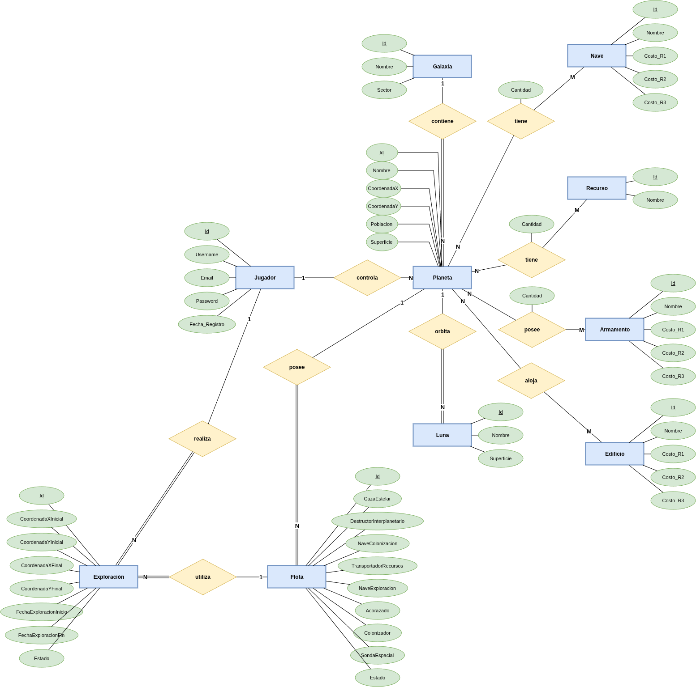
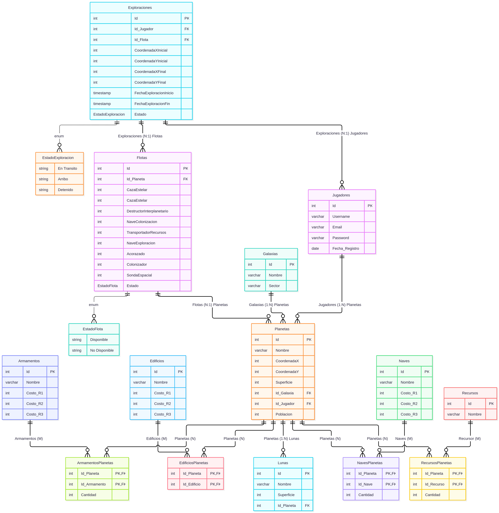

\newpage

# Parte 1: Ampliar Base de Datos

## 1. Planetas

@include p2-01-planetas.md

## 2. Naves

@include p2-02-naves.md

## 3. Creacion de Tablas

@include p2-03-tablas.md

## 4. DER y Modelo Lógico

### Diagrama Entidad/Relación (DER)

A partir de la consigna podemos determinar que el DER es:

\newpage

### Modelo Lógico

A partir del DER, podemos refinar el modelo, creando tablas pivote donde sea
necesario.

\newpage

# Parte 2: Queries

## 1. `cosmic_explorer` envia una Sonda Espacial

@include p2-05.1-queries.md

## 2. La expedicion de `cosmic_explorer` se detiene

@include p2-05.2-queries.md

## 3. `galacic_ruler` crea 2 flotas

@include p2-05.3-queries.md

## 4. `Fundacion` intercepta a `galacic_ruler`

-> Muy buena referencia a Asimov +5 puntos de respeto

@include p2-05.4-queries.md

## 5. `galactic_ruler` contraataca

@include p2-05.5-queries.md
