\newpage

# Parte 1: Ampliar Base de Datos

## 1. Planetas

```sql
ALTER TABLE Planetas
ADD COLUMN Poblacion BIGINT NOT NULL DEFAULT 0;
```

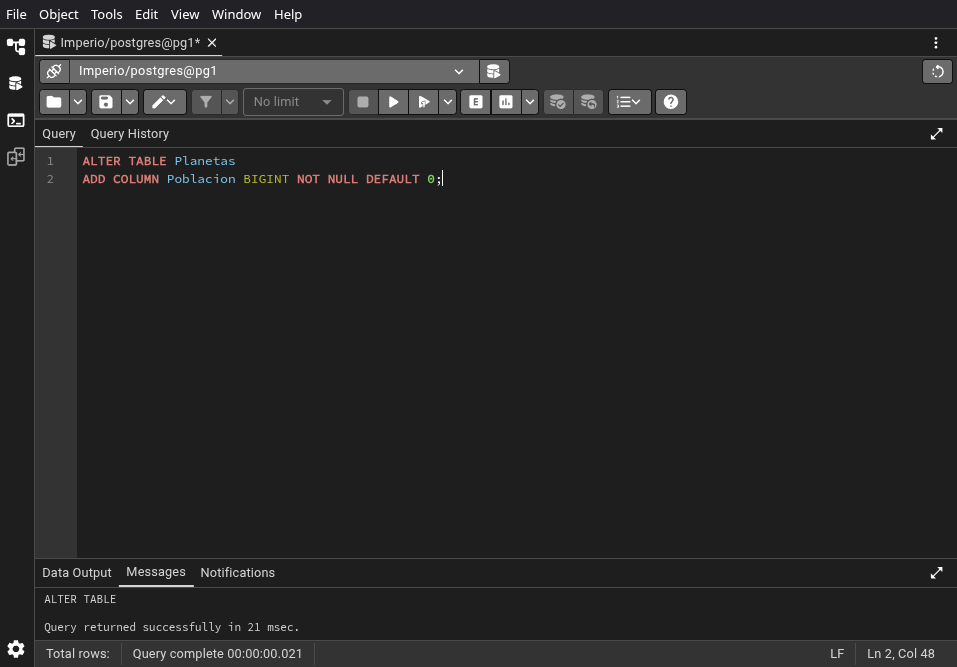

\newpage

```sql
UPDATE Planetas
    SET Poblacion = 4050000000
WHERE Nombre = 'Nova Prime'
;
```

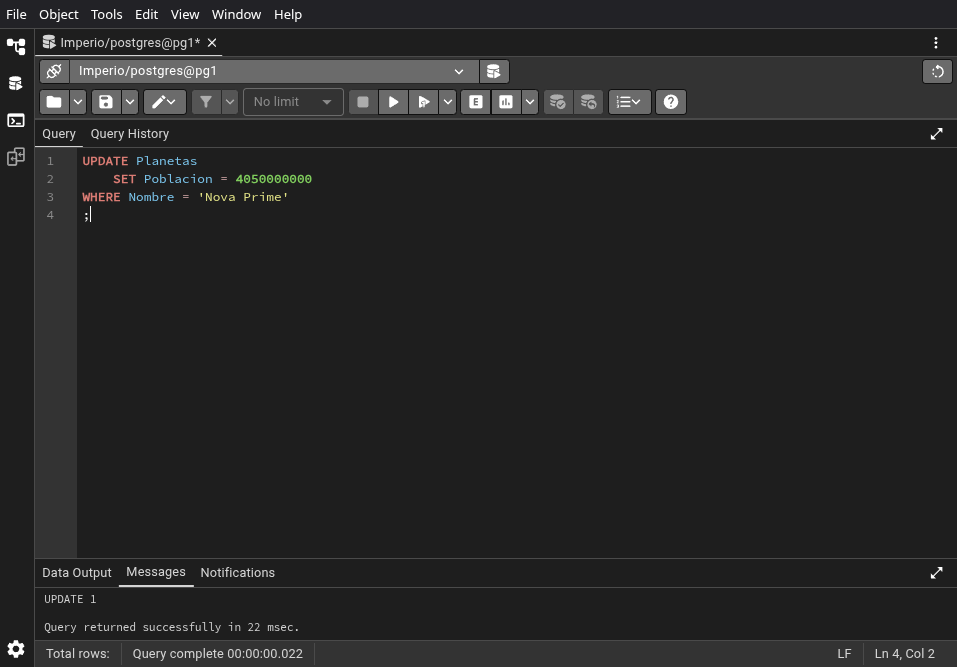

\newpage

```sql
UPDATE Planetas
    SET Poblacion = 3000000
WHERE Nombre = 'Stellar Haven'
;
```

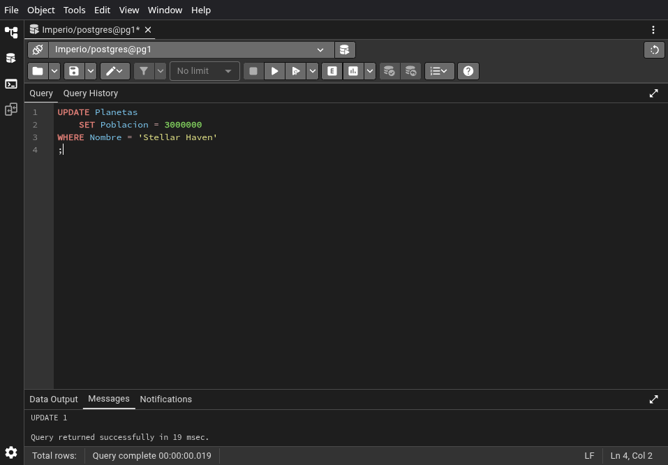

\newpage

```sql
UPDATE Planetas
    SET Poblacion = 9000000000
WHERE Nombre = 'Astral Oasis'
;
```


\newpage

```sql
UPDATE Planetas
    SET Poblacion = 20000000
WHERE Nombre = 'Celestial Outpost'
;
```


\newpage

```sql
UPDATE Planetas
    SET Poblacion = 1500000000
WHERE Nombre = 'Galactic Citadel'
;
```


\newpage

```sql
UPDATE Planetas
    SET Poblacion = 15000000
WHERE Nombre = 'Starlight Sanctuary'
;
```


\newpage

```sql
UPDATE Planetas
    SET Poblacion = 100000000
WHERE Nombre = 'Celestial Outpost II'
;
```


\newpage

```sql
UPDATE Planetas
    SET Poblacion = 5000000
WHERE Nombre = 'Nebula Nexus'
;
```

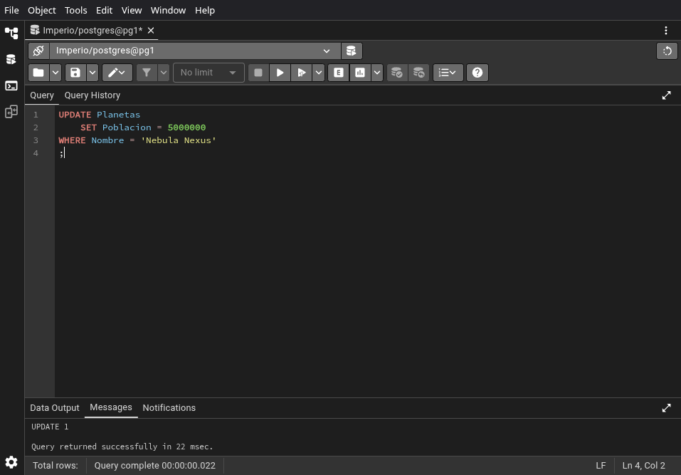

\newpage

```sql
UPDATE Planetas
    SET Poblacion = 50000000
WHERE Nombre = 'Solar Haven'
;
```

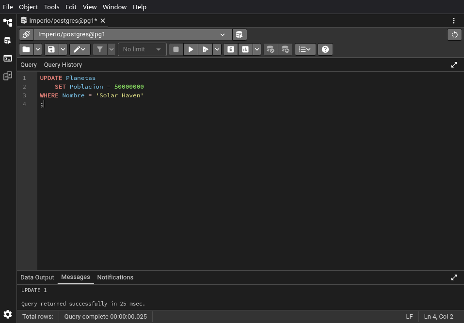

\newpage

```sql
UPDATE Planetas
    SET Poblacion = 2000000000
WHERE Nombre = 'Asteroid Haven'
;
```


\newpage

## 2. Naves

```sql
INSERT INTO Naves (Nombre, Costo_R1, Costo_R2, Costo_R3)
VALUES ('Acorazado', 2000, 500, 800)
;
```


\newpage

```sql
INSERT INTO Naves (Nombre, Costo_R1, Costo_R2, Costo_R3)
VALUES ('Colonizador', 1000, 800, 450)
;
```

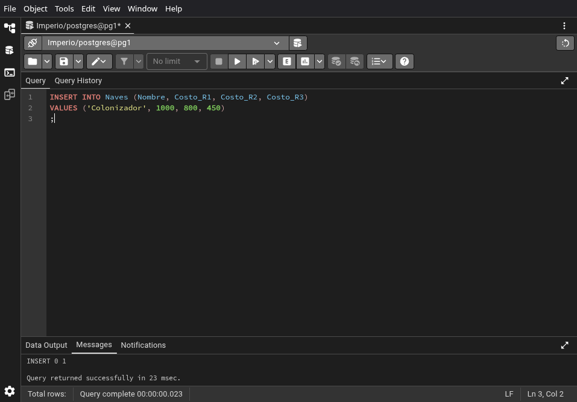

\newpage

```sql
INSERT INTO Naves (Nombre, Costo_R1, Costo_R2, Costo_R3)
VALUES ('Sonda Espacial', 100, 50, 30)
;
```


\newpage

## 3. Creacion de Tablas

```sql
CREATE TYPE EstadoFlota AS ENUM ('Disponible', 'No Disponible');
```

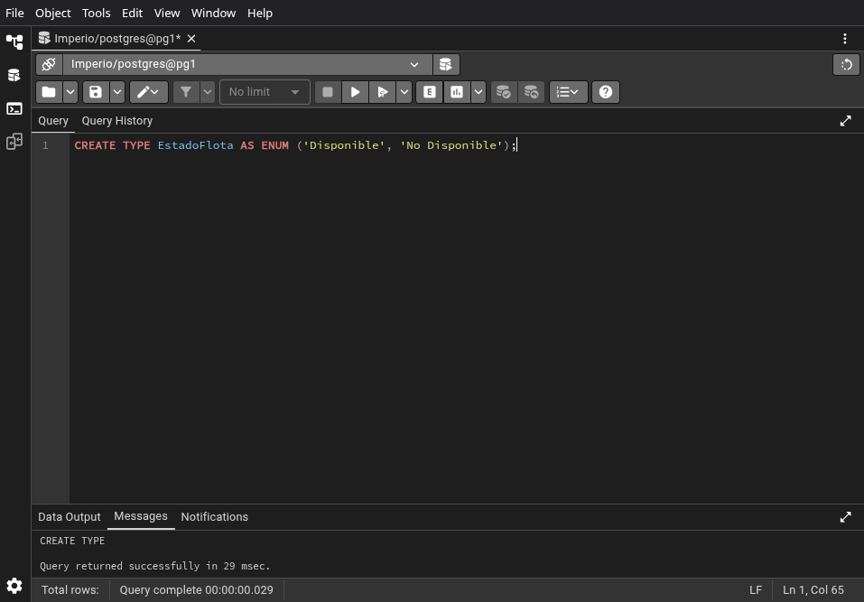

\newpage

```sql
CREATE TABLE Flotas (
    Id SERIAL PRIMARY KEY,
    Id_Planeta INT NOT NULL REFERENCES Planetas(Id),
    CazaEstelar INT DEFAULT 0,
    DestructorInterplanetario INT DEFAULT 0,
    NaveColonizacion INT DEFAULT 0,
    TransportadorRecursos INT DEFAULT 0,
    NaveExploracion INT DEFAULT 0,
    Acorazado INT DEFAULT 0,
    Colonizador INT DEFAULT 0,
    SondaEspacial INT DEFAULT 0,
    Estado EstadoFlota NOT NULL
);
```

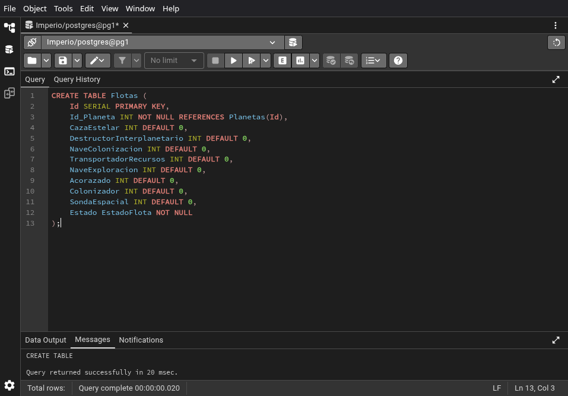

\newpage

```sql
CREATE TYPE EstadoExploracion AS ENUM ('En Tránsito', 'Arribo', 'Detenido');
```

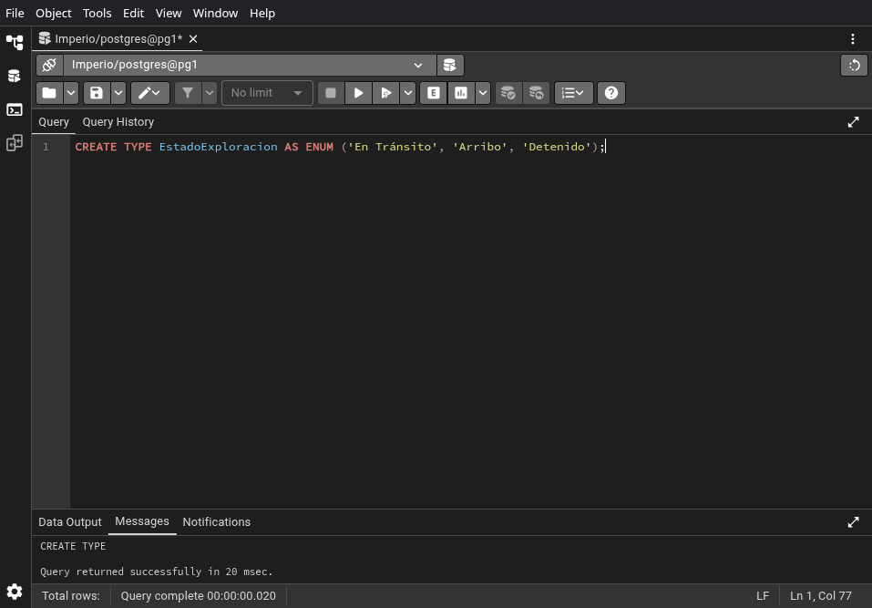

\newpage

```sql
CREATE TABLE Exploraciones (
    Id SERIAL PRIMARY KEY,
    Id_Jugador INT NOT NULL REFERENCES Jugadores(Id),
    Id_Flota INT NOT NULL REFERENCES Flotas(Id),
    CoordenadaXInicial INT NOT NULL,
    CoordenadaYInicial INT NOT NULL,
    CoordenadaXFinal INT NOT NULL,
    CoordenadaYFinal INT NOT NULL,
    FechaExploracionInicio TIMESTAMP NOT NULL,
    FechaExploracionFin TIMESTAMP NOT NULL,
    Estado EstadoExploracion NOT NULL
);
```

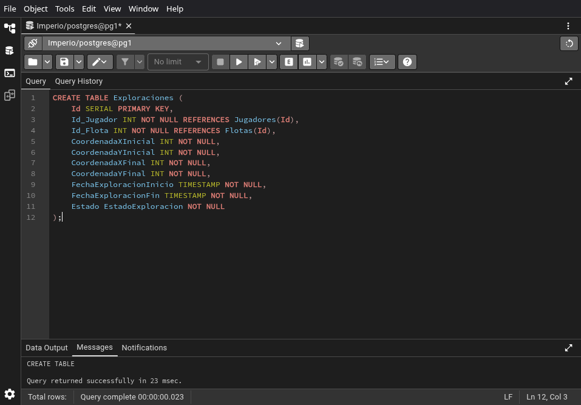

\newpage

## 4. DER y Modelo Lógico

### Diagrama Entidad/Relación (DER)

A partir de la consigna podemos determinar que el DER es:

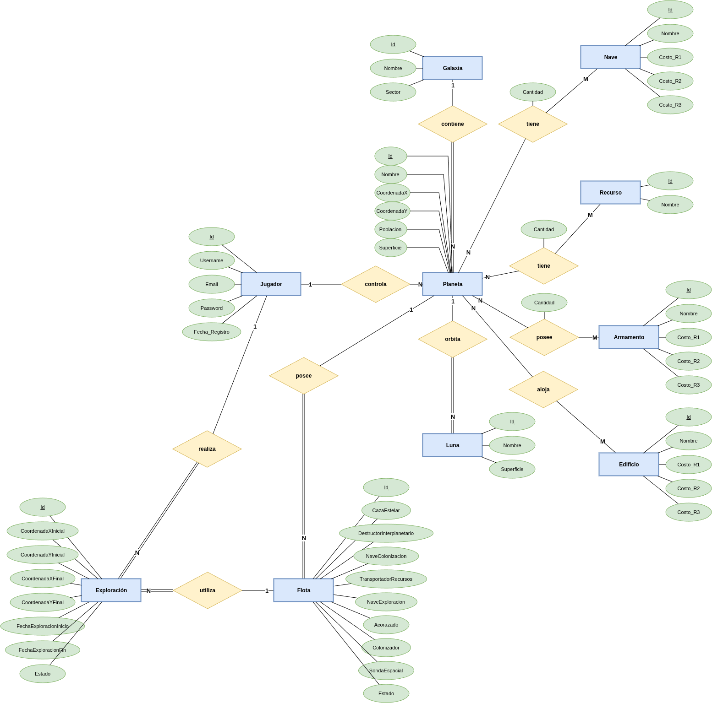

\newpage

### Modelo Lógico

A partir del DER, podemos refinar el modelo, creando tablas pivote donde sea
necesario.

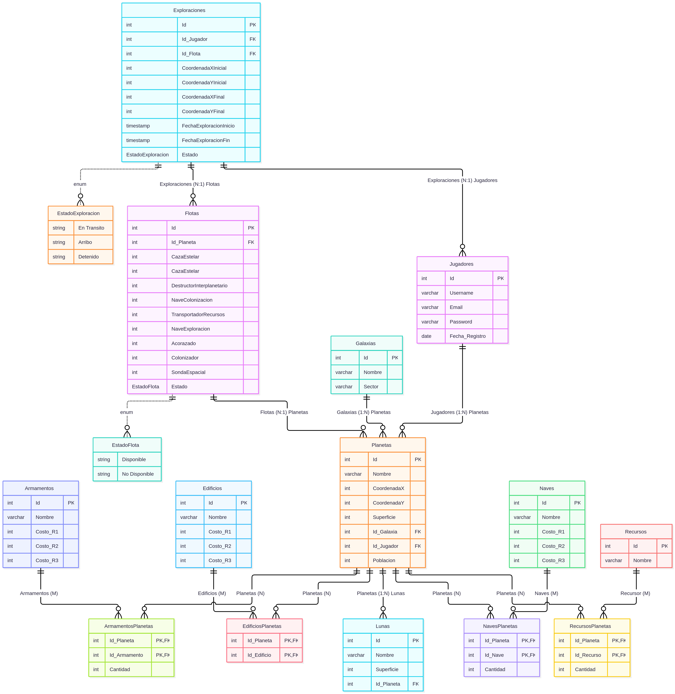

\newpage

# Parte 2: Queries

## 1. `cosmic_explorer` envia una Sonda Espacial

```sql
-- Primero, cosmic_explorer tiene que crear una Sonda Espacial
-- Solo tiene 1 planeta (Nexus Nebula)

-- Nebula Nexus -> 1x Sonda Espacial
INSERT INTO NavesPlanetas (Id_Planeta, Id_Nave, Cantidad)
VALUES (
    (
        SELECT P.Id
        FROM Planetas P
        INNER JOIN Jugadores J ON J.Id = P.Id_Jugador
        WHERE J.Username = 'cosmic_explorer'
          AND P.Nombre = 'Nebula Nexus'
    ),
    (SELECT Id FROM Naves WHERE Nombre = 'Sonda Espacial'),
    1
);
```

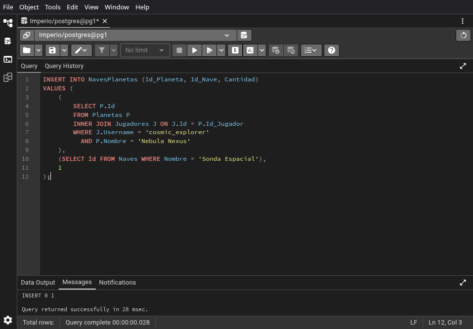

\newpage

```sql
-- Actualizamos los recursos del planeta:
UPDATE RecursosPlanetas
SET Cantidad = Cantidad - (
    (SELECT Costo_R1 FROM Naves WHERE Nombre = 'Sonda Espacial')
)
WHERE Id_Planeta = (
    SELECT P.Id
    FROM Planetas P
    INNER JOIN Jugadores J ON J.Id = P.Id_Jugador
    WHERE J.Username = 'cosmic_explorer'
      AND P.Nombre = 'Nebula Nexus'
)
AND Id_Recurso = 1;
```


\newpage

```sql
UPDATE RecursosPlanetas
SET Cantidad = Cantidad - (
    (SELECT Costo_R2 FROM Naves WHERE Nombre = 'Sonda Espacial')
)
WHERE Id_Planeta = (
    SELECT P.Id
    FROM Planetas P
    INNER JOIN Jugadores J ON J.Id = P.Id_Jugador
    WHERE J.Username = 'cosmic_explorer'
      AND P.Nombre = 'Nebula Nexus'
)
AND Id_Recurso = 2;
```

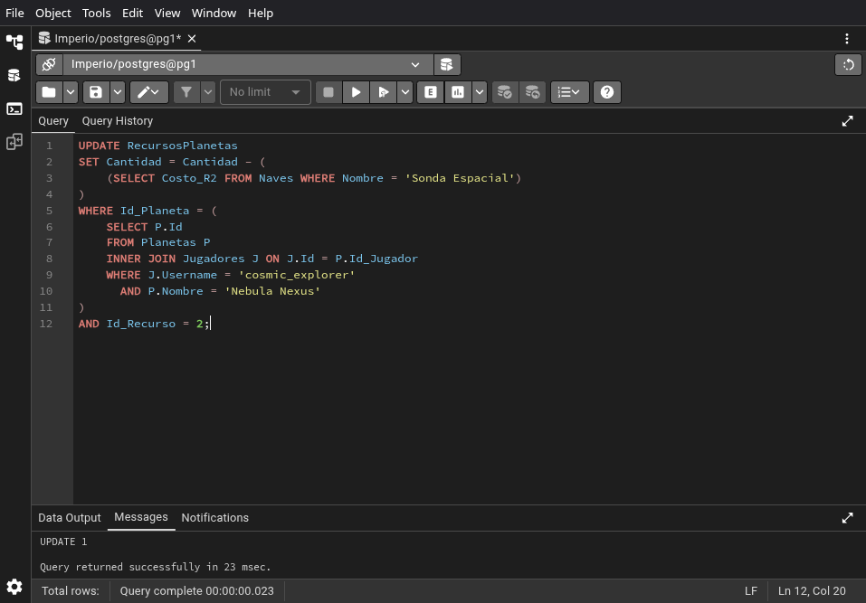

\newpage

```sql
UPDATE RecursosPlanetas
SET Cantidad = Cantidad - (
    (SELECT Costo_R3 FROM Naves WHERE Nombre = 'Sonda Espacial')
)
WHERE Id_Planeta = (
    SELECT P.Id
    FROM Planetas P
    INNER JOIN Jugadores J ON J.Id = P.Id_Jugador
    WHERE J.Username = 'cosmic_explorer'
      AND P.Nombre = 'Nebula Nexus'
)
AND Id_Recurso = 3;
```


\newpage

```sql
-- Creamos la Flota
INSERT INTO Flotas (Id_Planeta, SondaEspacial, Estado)
VALUES (
    (SELECT P.Id
    FROM Planetas P
    INNER JOIN Jugadores J ON J.Id = P.Id_Jugador
    WHERE J.Username = 'cosmic_explorer'
      AND P.Nombre = 'Nebula Nexus'),
    1,
    'Disponible'
) -- esto resulta en Flota con ID = 1
;
```

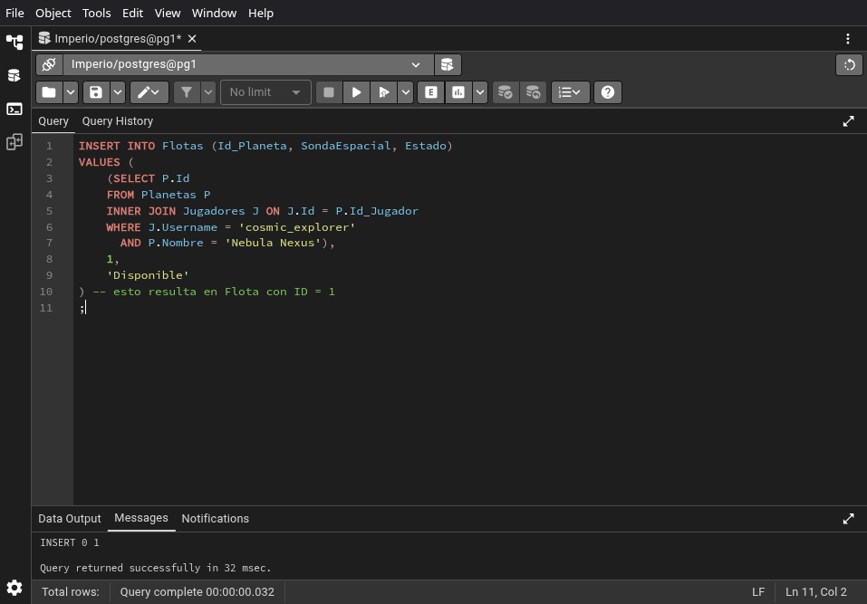

\newpage

```sql
-- Reducimos la cantidad de Sondas Espaciales de Nebula Nexus por 1
UPDATE NavesPlanetas
SET Cantidad = Cantidad - 1
WHERE Id_Planeta = (
    SELECT P.Id FROM Planetas P
    INNER JOIN Jugadores J ON J.Id = P.Id_Jugador
    WHERE P.Nombre = 'Nebula Nexus' AND J.Username = 'cosmic_explorer'
)
AND Id_Nave = (SELECT Id FROM Naves WHERE Nombre = 'Sonda Espacial')
;
```

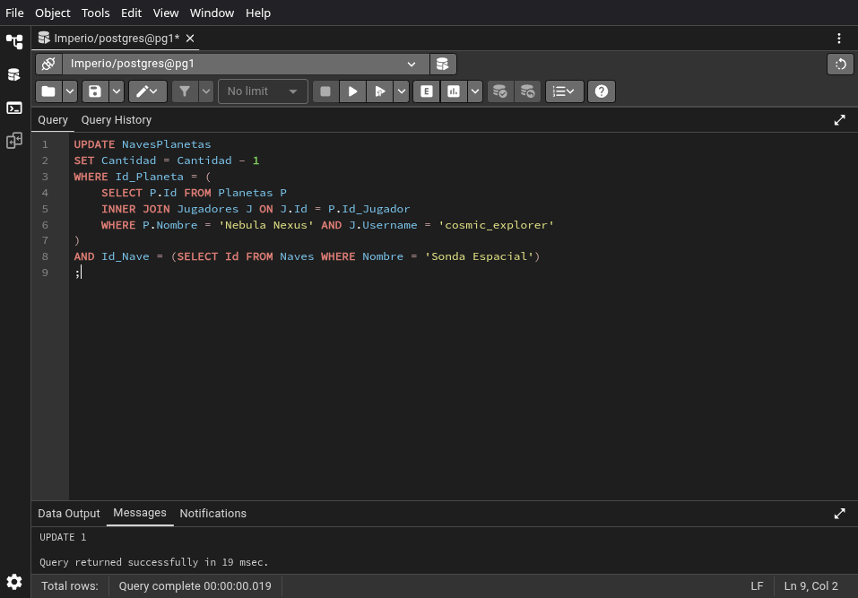

\newpage

```sql
-- Creamos la Exploracion
INSERT INTO Exploraciones (
    Id_Jugador, Id_Flota,
    CoordenadaXInicial, CoordenadaYInicial,
    CoordenadaXFinal, CoordenadaYFinal,
    FechaExploracionInicio, FechaExploracionFin,
    Estado
) VALUES (
    (SELECT Id FROM Jugadores WHERE Username = 'cosmic_explorer'),
    1, -- Id_Flota => 1
    (SELECT CoordenadaX FROM Planetas P
        INNER JOIN Jugadores J ON J.Id = P.Id_Jugador
        WHERE J.Username = 'cosmic_explorer' AND P.Nombre = 'Nebula Nexus'
    ),
    (SELECT CoordenadaY FROM Planetas P
        INNER JOIN Jugadores J ON J.Id = P.Id_Jugador
        WHERE J.Username = 'cosmic_explorer' AND P.Nombre = 'Nebula Nexus'
    ),
    45, 78, -- Coordenadas finales X,Y
    NOW(), NOW() + INTERVAL '20 hours', -- fecha inicio, fecha fin
    'En Tránsito'   
) -- Resulta en Id_Exploracion = 1
;
```

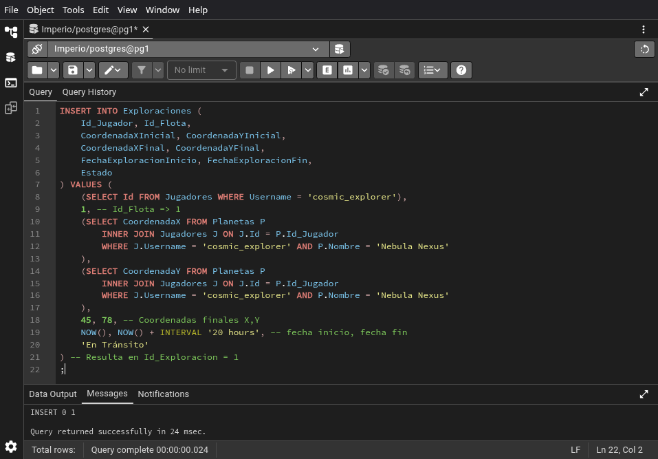

\newpage

```sql
-- Marcamos la Flota como `no disponible`
UPDATE Flotas
SET Estado = 'No Disponible'
WHERE Id = 1 -- Id_Flota => 1
;
```


\newpage

## 2. La expedicion de `cosmic_explorer` se detiene

```sql
-- La sonda pasa por un campo de meteoritos -> la Exploracion se detiene
UPDATE Exploraciones
SET Estado = 'Detenido'
WHERE Id = 1 -- Id_Exploracion = 1
;
```

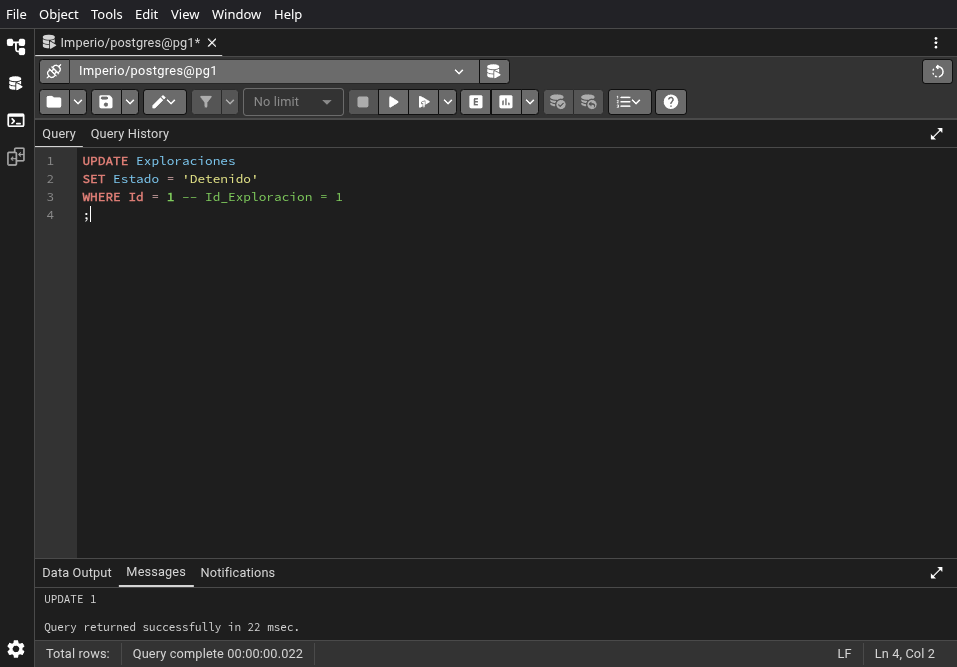

\newpage

## 3. `galacic_ruler` crea 2 flotas

```sql
-- galactic_ruler crea 5 Sondas Espaciales
-- En el planeta Stellar Haven

-- Stellar Haven -> 5x Sonda Espacial
INSERT INTO NavesPlanetas (Id_Planeta, Id_Nave, Cantidad)
VALUES (
    (
        SELECT Id FROM Planetas
        WHERE Nombre = 'Stellar Haven'
    ),
    (SELECT Id FROM Naves WHERE Nombre = 'Sonda Espacial'),
    5
);
```

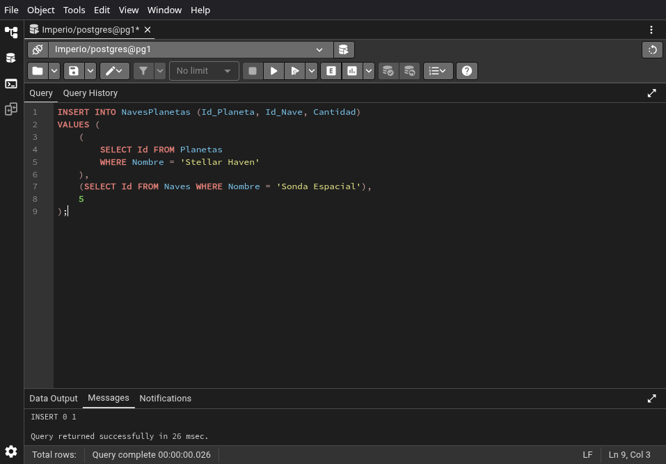

\newpage

```sql
-- Actualizamos los recursos del planeta:
UPDATE RecursosPlanetas
SET Cantidad = Cantidad - (
    5 * (SELECT Costo_R1 FROM Naves WHERE Nombre = 'Sonda Espacial')
)
WHERE Id_Planeta = (
    SELECT Id FROM Planetas
    WHERE Nombre = 'Stellar Haven'
)
AND Id_Recurso = 1;
```

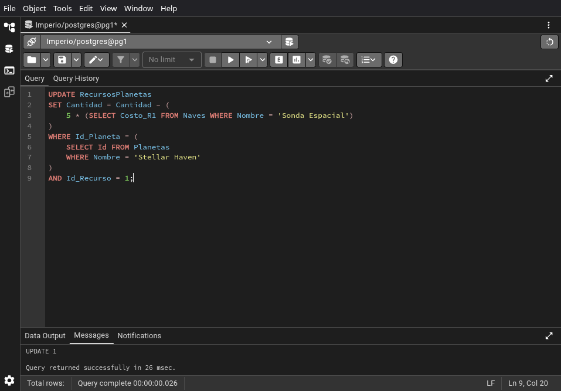

\newpage

```sql
UPDATE RecursosPlanetas
SET Cantidad = Cantidad - (
    5 * (SELECT Costo_R2 FROM Naves WHERE Nombre = 'Sonda Espacial')
)
WHERE Id_Planeta = (
    SELECT Id FROM Planetas
    WHERE Nombre = 'Stellar Haven'
)
AND Id_Recurso = 2;
```


\newpage

```sql
UPDATE RecursosPlanetas
SET Cantidad = Cantidad - (
    5 * (SELECT Costo_R3 FROM Naves WHERE Nombre = 'Sonda Espacial')
)
WHERE Id_Planeta = (
    SELECT Id FROM Planetas
    WHERE Nombre = 'Stellar Haven'
)
AND Id_Recurso = 3;
```


\newpage

```sql
-- Reducimos la cantidad de Sondas Espaciales de Stellar Haven por 5
UPDATE NavesPlanetas
SET Cantidad = Cantidad - 5
WHERE Id_Planeta = (
    SELECT Id FROM Planetas
    WHERE Nombre = 'Stellar Haven'
)
AND Id_Nave = (SELECT Id FROM Naves WHERE Nombre = 'Sonda Espacial')
;
```

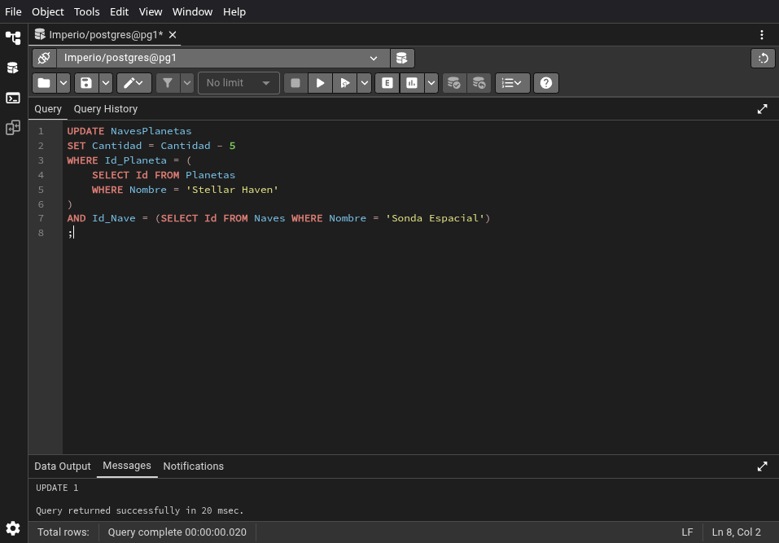

\newpage

```sql
-- Creamos la Flota
INSERT INTO Flotas (Id_Planeta, SondaEspacial, Estado)
VALUES (
    (SELECT Id FROM Planetas
    WHERE Nombre = 'Stellar Haven'),
    5,
    'Disponible'
) -- esto resulta en Flota con ID = 2
;
```

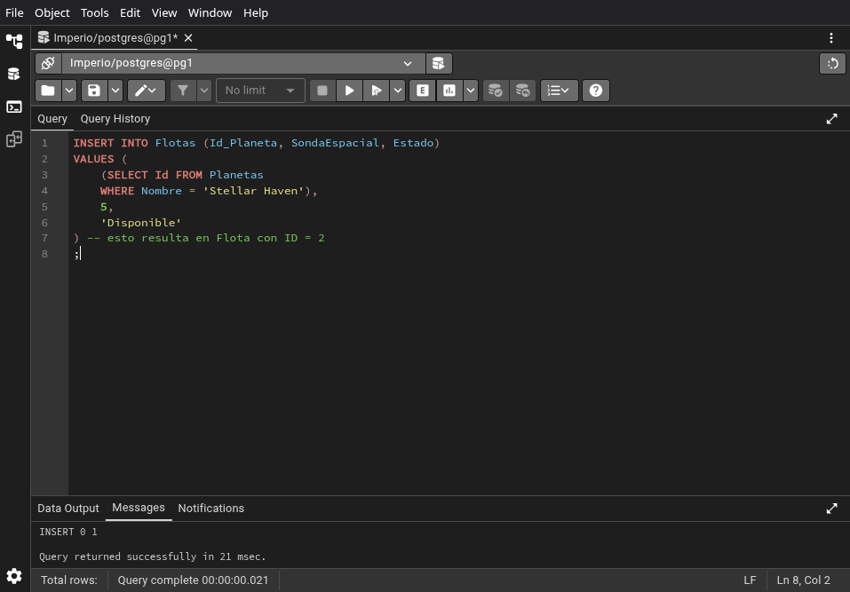

\newpage

```sql
-- Creamos la Exploracion
INSERT INTO Exploraciones (
    Id_Jugador, Id_Flota,
    CoordenadaXInicial, CoordenadaYInicial,
    CoordenadaXFinal, CoordenadaYFinal,
    FechaExploracionInicio, FechaExploracionFin,
    Estado
) VALUES (
    (SELECT Id FROM Jugadores WHERE Username = 'galactic_ruler'),
    2, -- Id_Flota => 2
    (SELECT CoordenadaX FROM Planetas WHERE Nombre = 'Stellar Haven'),
    (SELECT CoordenadaY FROM Planetas WHERE Nombre = 'Stellar Haven'),
    14, 24, -- Coordenadas finales X,Y
    NOW(), NOW() + INTERVAL '15 hours', -- fecha inicio, fecha fin
    'En Tránsito'   
)
;
```

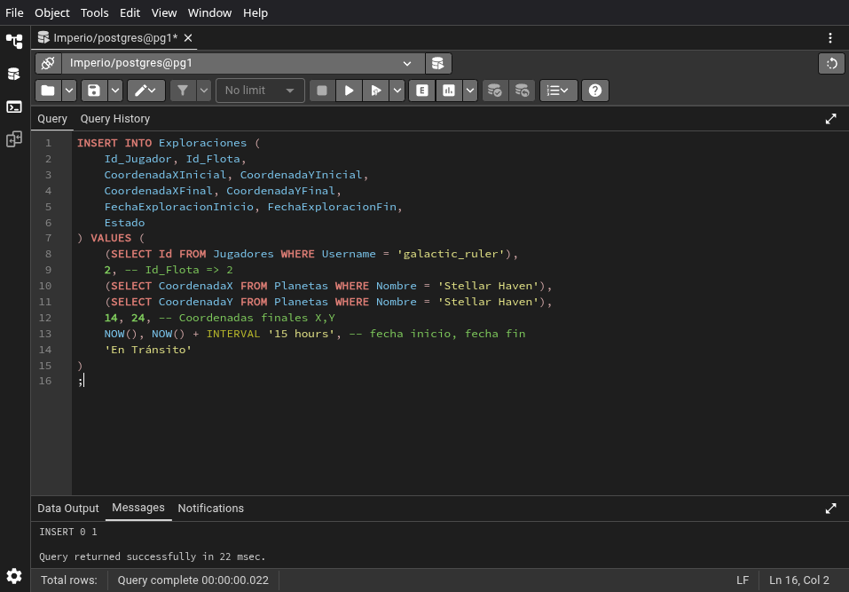

\newpage

```sql
-- Marcamos la Flota como `no disponible`
UPDATE Flotas
SET Estado = 'No Disponible'
WHERE Id = 2 -- Id_Flota => 2
;
```

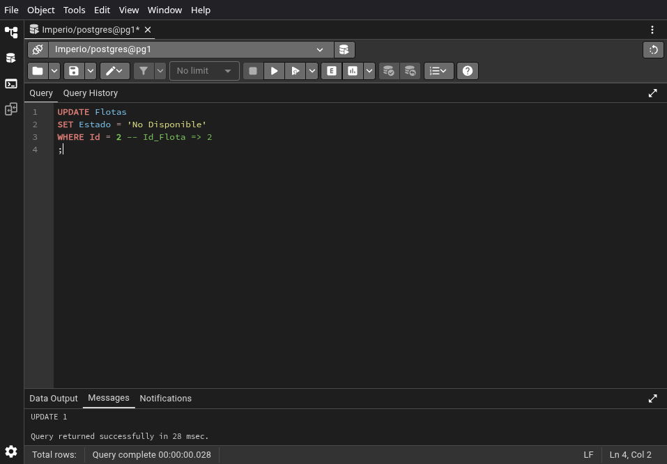

\newpage

```sql
-- Crea una nueva Flota con:
-- - 20x Cazas Estelares
-- - 5x Nave de Colonizacion
-- - 10x Transportador de Recursos
INSERT INTO Flotas (Id_Planeta, CazaEstelar, NaveColonizacion, TransportadorRecursos, Estado)
VALUES (
    (SELECT Id FROM Planetas
    WHERE Nombre = 'Stellar Haven'),
    20,
    5,
    10,
    'Disponible'
) -- esto resulta en Flota con ID = 3
;
```

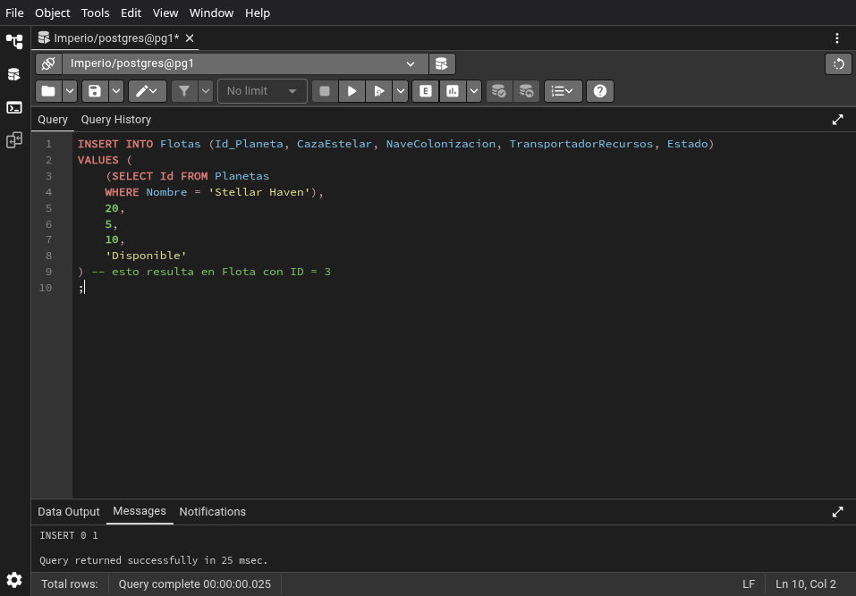

\newpage

```sql
-- Actualizamos las naves en Stellar Haven
UPDATE NavesPlanetas
    SET Cantidad = Cantidad - 20
WHERE Id_Planeta = (SELECT Id FROM Planetas WHERE Nombre = 'Stellar Haven')
AND Id_Nave = (SELECT Id FROM Naves WHERE Nombre = 'Caza Estelar')
;
```


\newpage

```sql
UPDATE NavesPlanetas
    SET Cantidad = Cantidad - 5
WHERE Id_Planeta = (SELECT Id FROM Planetas WHERE Nombre = 'Stellar Haven')
AND Id_Nave = (SELECT Id FROM Naves WHERE Nombre = 'Nave de Colonización')
;
```


\newpage

```sql
UPDATE NavesPlanetas
    SET Cantidad = Cantidad - 10
WHERE Id_Planeta = (SELECT Id FROM Planetas WHERE Nombre = 'Stellar Haven')
AND Id_Nave = (SELECT Id FROM Naves WHERE Nombre = 'Transportador de Recursos')
;
```

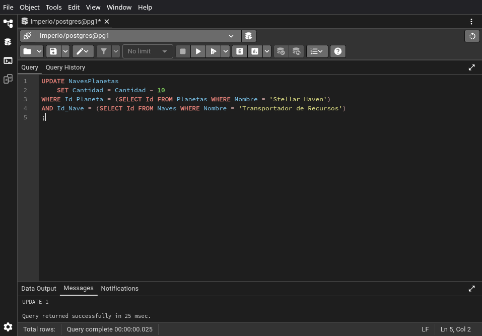

\newpage

## 4. `Fundacion` intercepta a `galacic_ruler`

-> Muy buena referencia a Asimov +5 puntos de respeto

```sql
-- Detenemos la exploracion de galactic_ruler, cambiamos las coordenadas finales
UPDATE Exploraciones
    SET Estado = 'Detenido',
        CoordenadaXFinal = 10,
        CoordenadaYFinal = 21
WHERE Id = 2
;
```

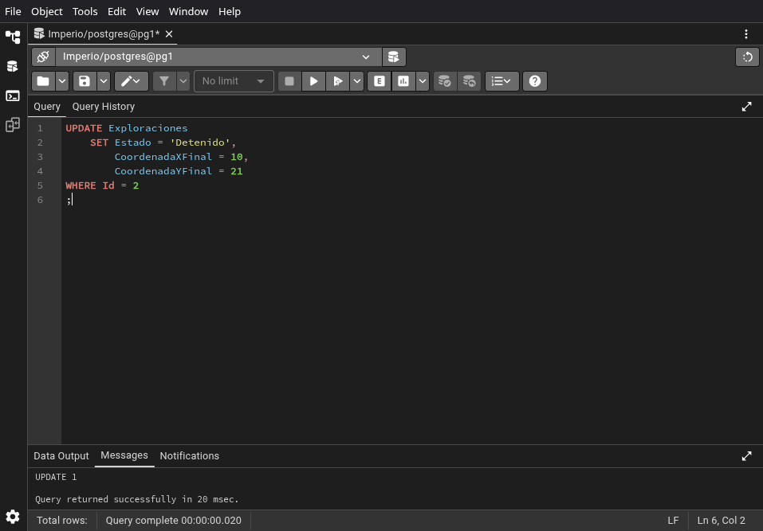

\newpage

## 5. `galactic_ruler` contraataca

```sql
-- Deshacemos la Flota: 3
UPDATE Flotas
    SET CazaEstelar = 0,
        NaveColonizacion = 0,
        TransportadorRecursos = 0,
        Estado = 'No Disponible'
WHERE Id = 3
;
```

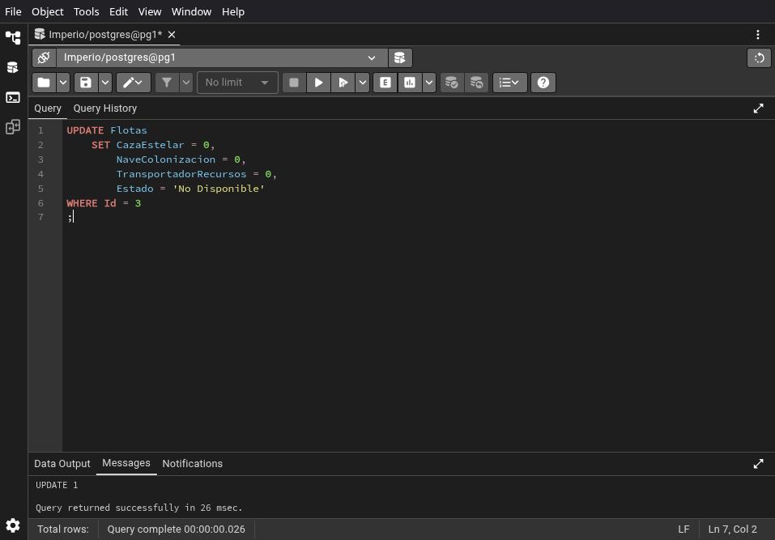

\newpage

```sql
-- Devolvemos las naves al planeta:
UPDATE NavesPlanetas
    SET Cantidad = Cantidad + 20
WHERE Id_Planeta = (SELECT Id FROM Planetas WHERE Nombre = 'Stellar Haven')
AND Id_Nave = (SELECT Id FROM Naves WHERE Nombre = 'Caza Estelar')
;
```


\newpage

```sql
UPDATE NavesPlanetas
    SET Cantidad = Cantidad + 5
WHERE Id_Planeta = (SELECT Id FROM Planetas WHERE Nombre = 'Stellar Haven')
AND Id_Nave = (SELECT Id FROM Naves WHERE Nombre = 'Nave de Colonización')
;
```


\newpage

```sql
UPDATE NavesPlanetas
    SET Cantidad = Cantidad + 10
WHERE Id_Planeta = (SELECT Id FROM Planetas WHERE Nombre = 'Stellar Haven')
AND Id_Nave = (SELECT Id FROM Naves WHERE Nombre = 'Transportador de Recursos')
;
```

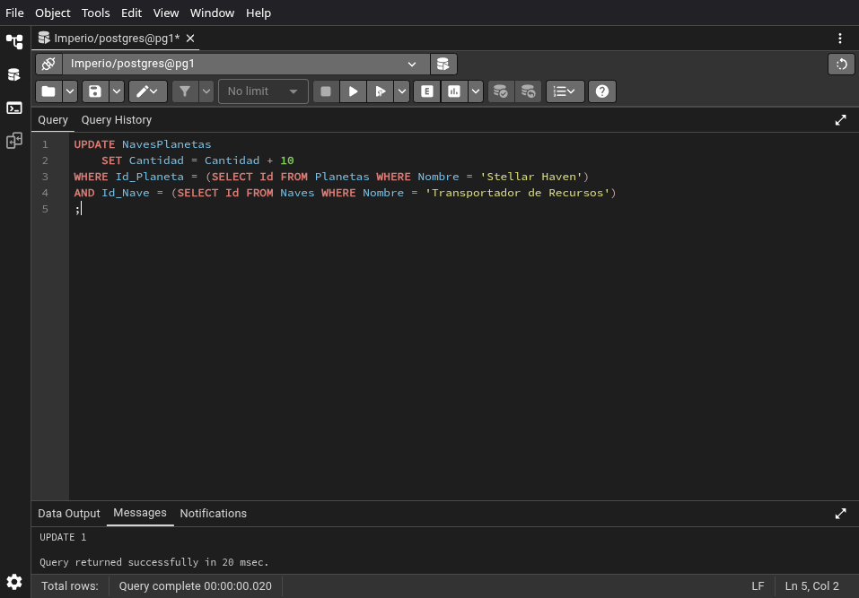

\newpage

```sql
-- Creamos la nueva Flota con:
-- - 50x Cazas Estelares
INSERT INTO Flotas (Id_Planeta, CazaEstelar, Estado)
VALUES (
    (SELECT Id FROM Planetas
    WHERE Nombre = 'Stellar Haven'),
    (SELECT Cantidad FROM NavesPlanetas NP
        INNER JOIN Naves N ON N.Id = NP.Id_Nave
        INNER JOIN Planetas P ON P.Id = NP.Id_Planeta
        WHERE P.Nombre = 'Stellar Haven' AND N.Nombre = 'Caza Estelar'
    ),
    'Disponible'
) -- esto resulta en Flota con ID = 4
;
```

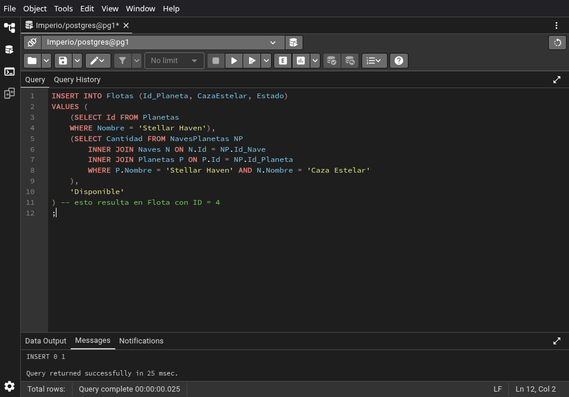

\newpage

```sql
-- Actualizamos las naves en Stellar Haven
UPDATE NavesPlanetas
    SET Cantidad = 0
WHERE Id_Planeta = (SELECT Id FROM Planetas WHERE Nombre = 'Stellar Haven')
AND Id_Nave = (SELECT Id FROM Naves WHERE Nombre = 'Caza Estelar')
;
```

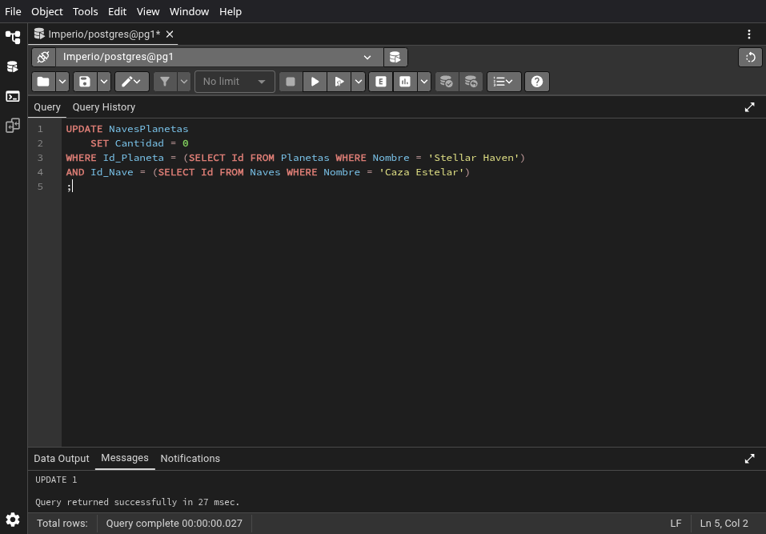

\newpage

```sql
-- Creamos la Exploracion
INSERT INTO Exploraciones (
    Id_Jugador, Id_Flota,
    CoordenadaXInicial, CoordenadaYInicial,
    CoordenadaXFinal, CoordenadaYFinal,
    FechaExploracionInicio, FechaExploracionFin,
    Estado
) VALUES (
    (SELECT Id FROM Jugadores WHERE Username = 'galactic_ruler'),
    4, -- Id_Flota => 4
    (SELECT CoordenadaX FROM Planetas WHERE Nombre = 'Stellar Haven'),
    (SELECT CoordenadaY FROM Planetas WHERE Nombre = 'Stellar Haven'),
    32, 1, -- Coordenadas finales X,Y
    NOW(), NOW() + INTERVAL '10 hours', -- fecha inicio, fecha fin
    'En Tránsito'   
);
```


\newpage

```sql
UPDATE Flotas
    SET Estado = 'No Disponible'
WHERE Id = 4
;
```

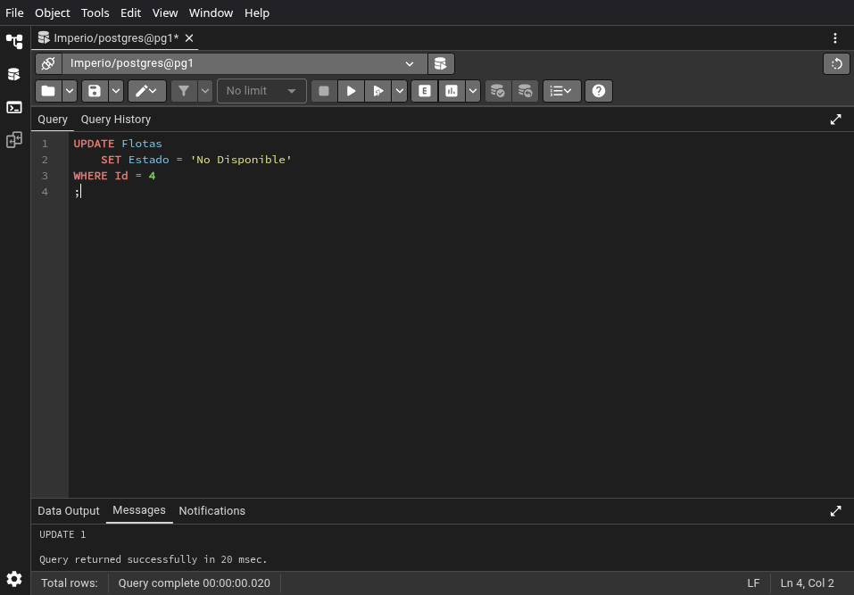

\newpage
