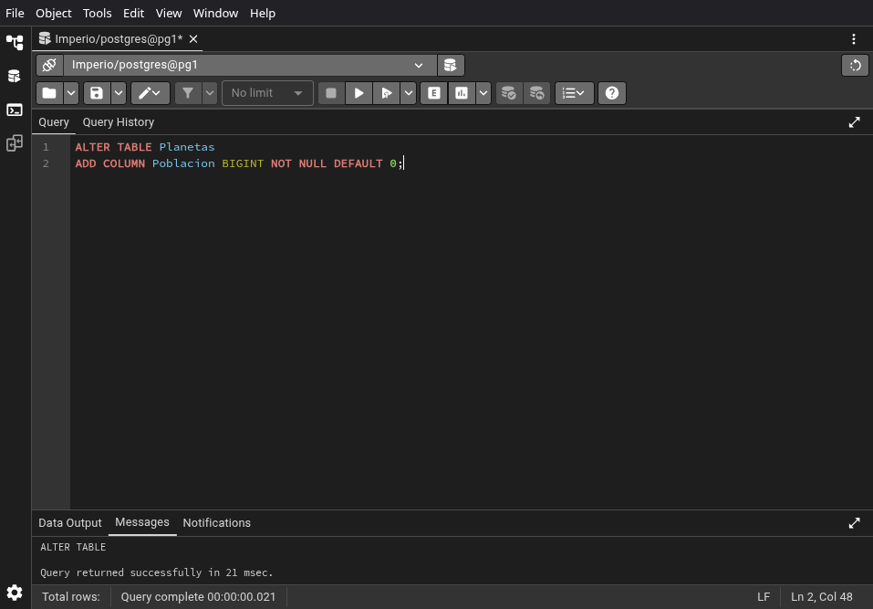
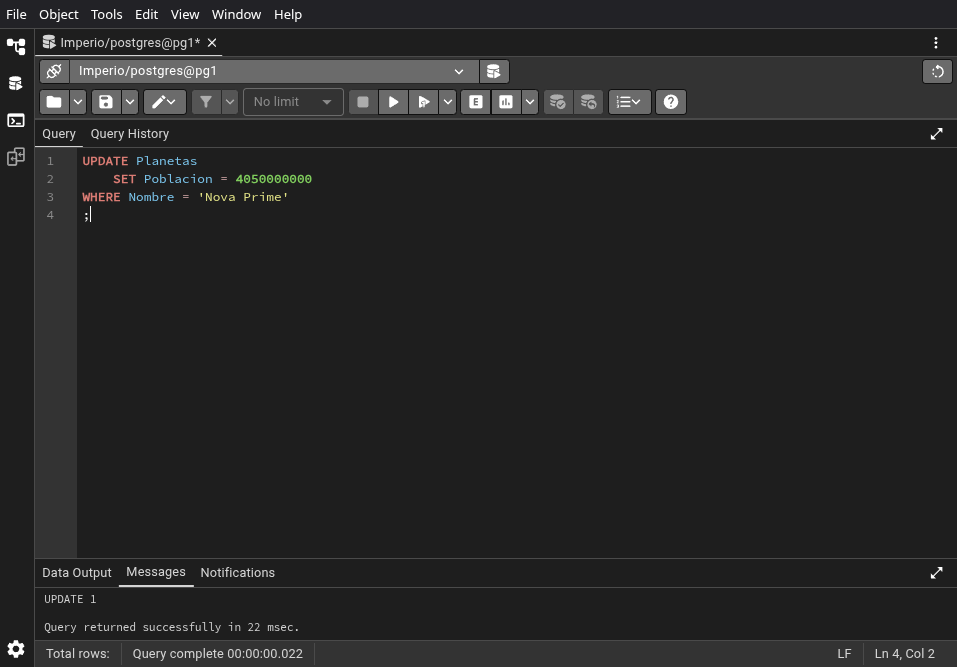
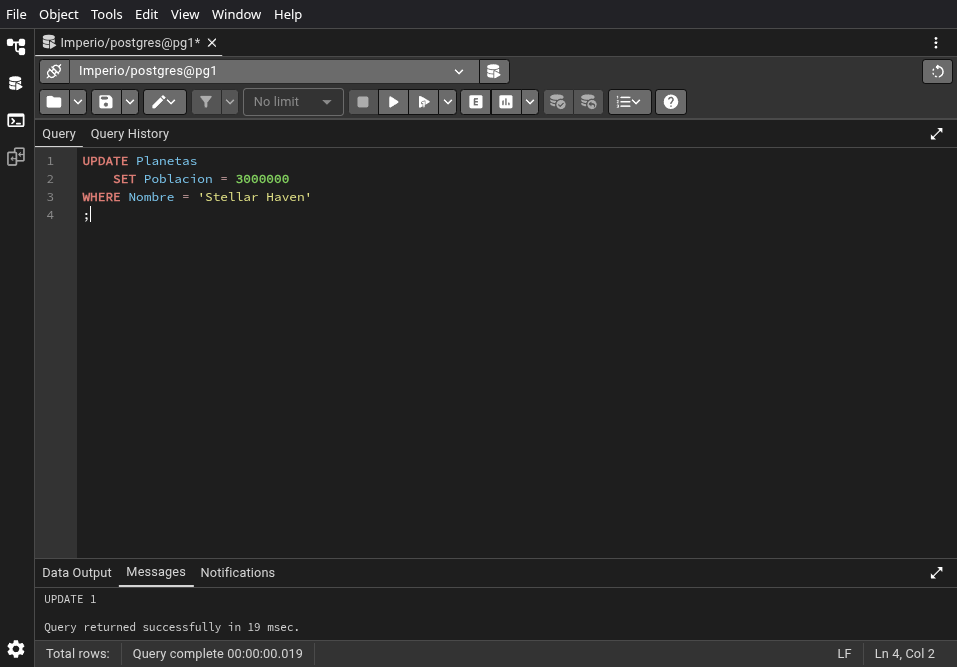
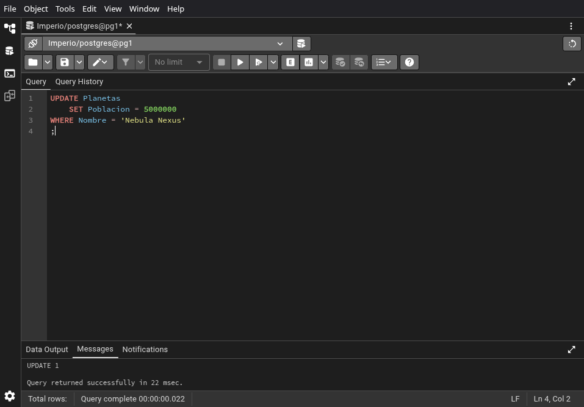
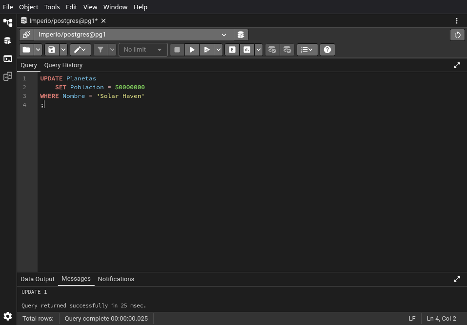

```sql
ALTER TABLE Planetas
ADD COLUMN Poblacion BIGINT NOT NULL DEFAULT 0;
```



\newpage


```sql
UPDATE Planetas
    SET Poblacion = 4050000000
WHERE Nombre = 'Nova Prime'
;
```



\newpage


```sql
UPDATE Planetas
    SET Poblacion = 3000000
WHERE Nombre = 'Stellar Haven'
;
```



\newpage


```sql
UPDATE Planetas
    SET Poblacion = 9000000000
WHERE Nombre = 'Astral Oasis'
;
```


\newpage


```sql
UPDATE Planetas
    SET Poblacion = 20000000
WHERE Nombre = 'Celestial Outpost'
;
```


\newpage


```sql
UPDATE Planetas
    SET Poblacion = 1500000000
WHERE Nombre = 'Galactic Citadel'
;
```


\newpage


```sql
UPDATE Planetas
    SET Poblacion = 15000000
WHERE Nombre = 'Starlight Sanctuary'
;
```


\newpage


```sql
UPDATE Planetas
    SET Poblacion = 100000000
WHERE Nombre = 'Celestial Outpost II'
;
```


\newpage


```sql
UPDATE Planetas
    SET Poblacion = 5000000
WHERE Nombre = 'Nebula Nexus'
;
```



\newpage


```sql
UPDATE Planetas
    SET Poblacion = 50000000
WHERE Nombre = 'Solar Haven'
;
```



\newpage


```sql
UPDATE Planetas
    SET Poblacion = 2000000000
WHERE Nombre = 'Asteroid Haven'
;
```


\newpage


