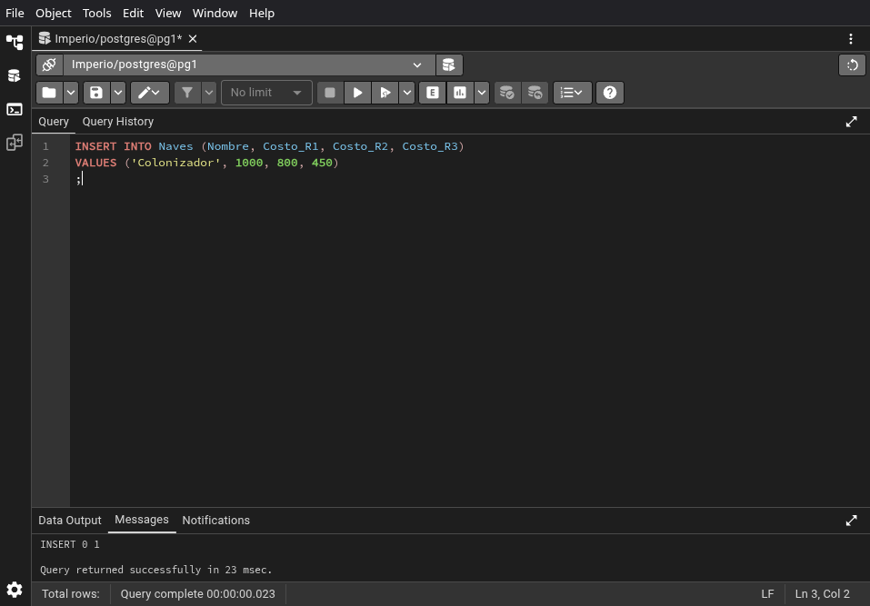

```sql
INSERT INTO Naves (Nombre, Costo_R1, Costo_R2, Costo_R3)
VALUES ('Acorazado', 2000, 500, 800)
;
```


\newpage


```sql
INSERT INTO Naves (Nombre, Costo_R1, Costo_R2, Costo_R3)
VALUES ('Colonizador', 1000, 800, 450)
;
```



\newpage


```sql
INSERT INTO Naves (Nombre, Costo_R1, Costo_R2, Costo_R3)
VALUES ('Sonda Espacial', 100, 50, 30)
;
```


\newpage


