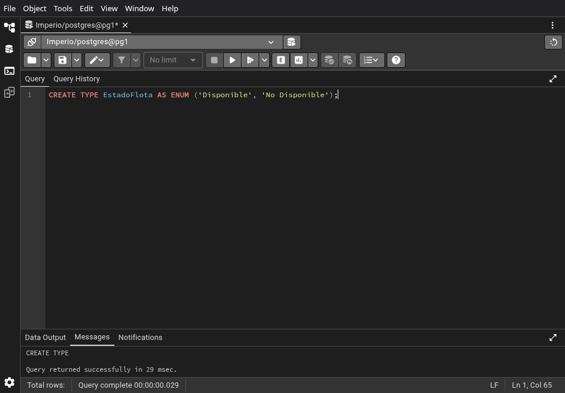
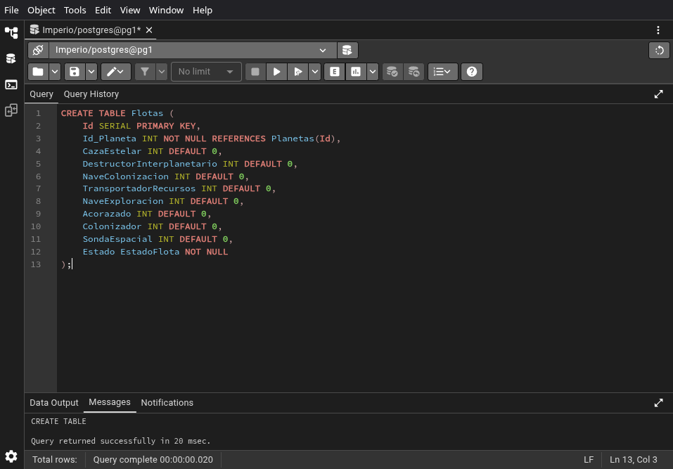
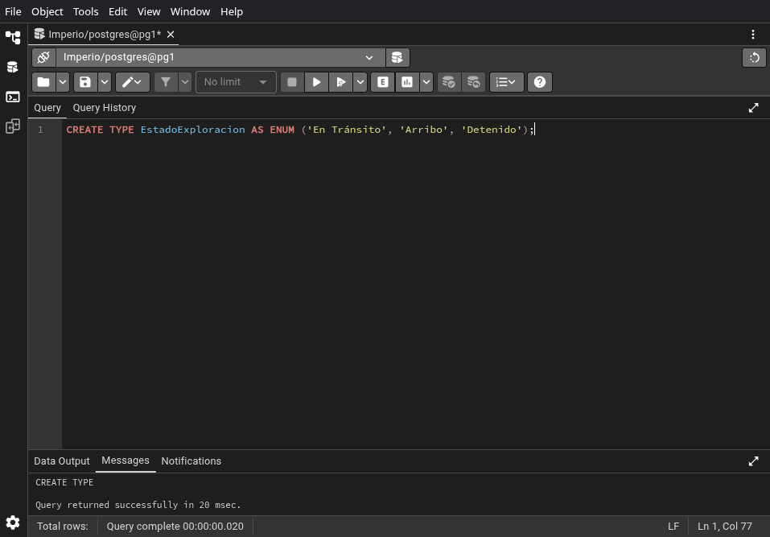
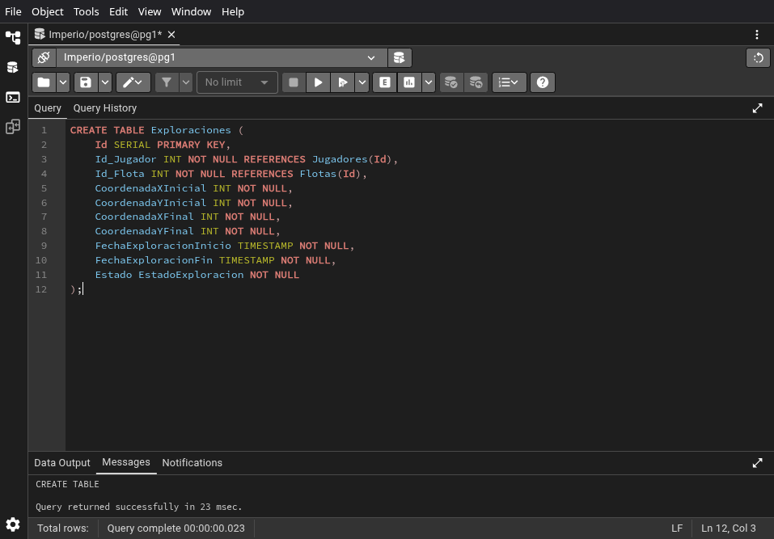

```sql
CREATE TYPE EstadoFlota AS ENUM ('Disponible', 'No Disponible');
```



\newpage


```sql
CREATE TABLE Flotas (
    Id SERIAL PRIMARY KEY,
    Id_Planeta INT NOT NULL REFERENCES Planetas(Id),
    CazaEstelar INT DEFAULT 0,
    DestructorInterplanetario INT DEFAULT 0,
    NaveColonizacion INT DEFAULT 0,
    TransportadorRecursos INT DEFAULT 0,
    NaveExploracion INT DEFAULT 0,
    Acorazado INT DEFAULT 0,
    Colonizador INT DEFAULT 0,
    SondaEspacial INT DEFAULT 0,
    Estado EstadoFlota NOT NULL
);
```



\newpage


```sql
CREATE TYPE EstadoExploracion AS ENUM ('En Tránsito', 'Arribo', 'Detenido');
```



\newpage


```sql
CREATE TABLE Exploraciones (
    Id SERIAL PRIMARY KEY,
    Id_Jugador INT NOT NULL REFERENCES Jugadores(Id),
    Id_Flota INT NOT NULL REFERENCES Flotas(Id),
    CoordenadaXInicial INT NOT NULL,
    CoordenadaYInicial INT NOT NULL,
    CoordenadaXFinal INT NOT NULL,
    CoordenadaYFinal INT NOT NULL,
    FechaExploracionInicio TIMESTAMP NOT NULL,
    FechaExploracionFin TIMESTAMP NOT NULL,
    Estado EstadoExploracion NOT NULL
);
```



\newpage


