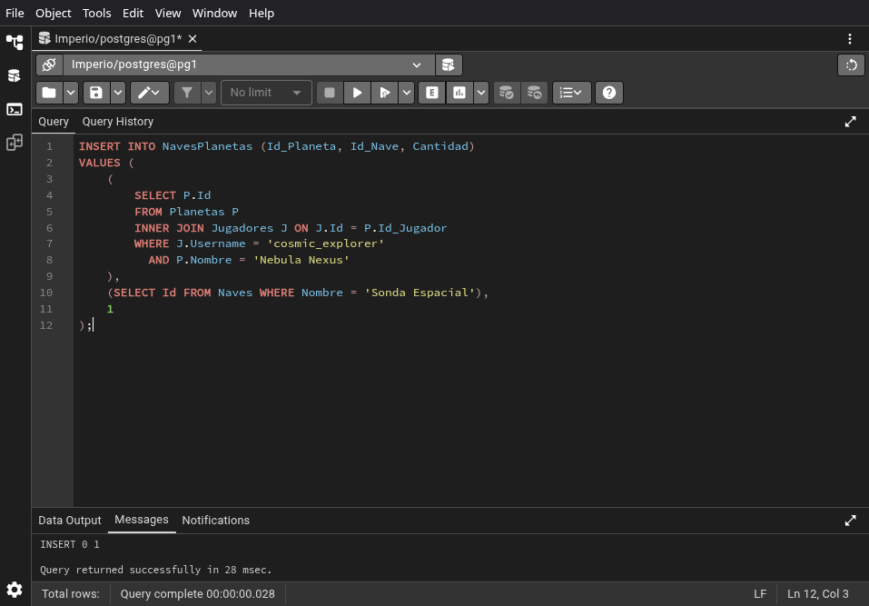
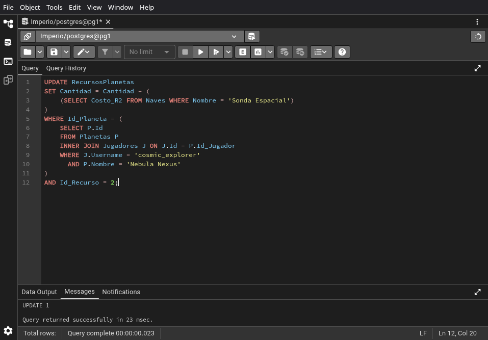
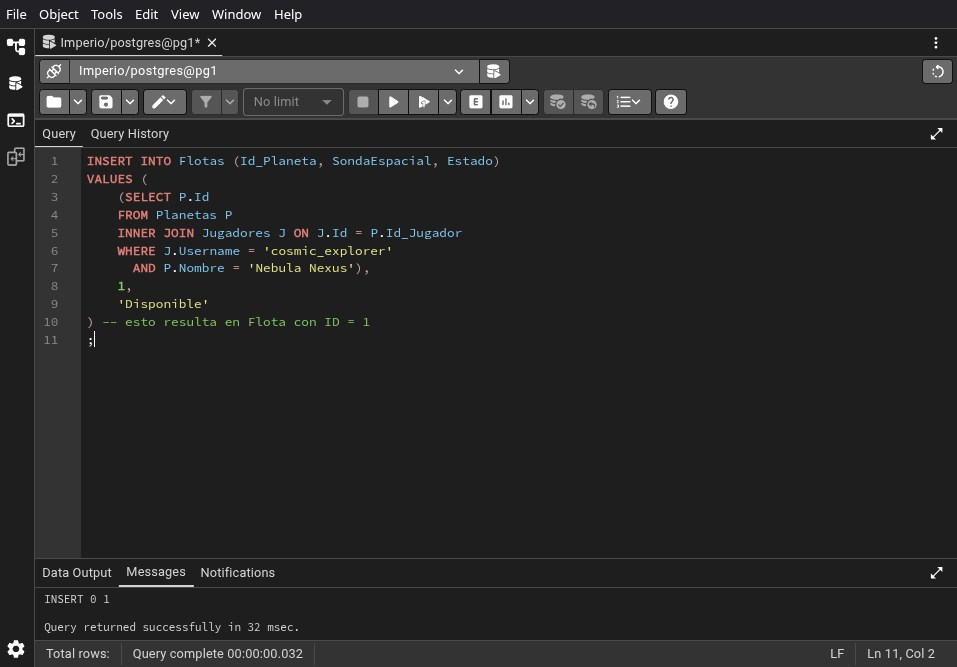
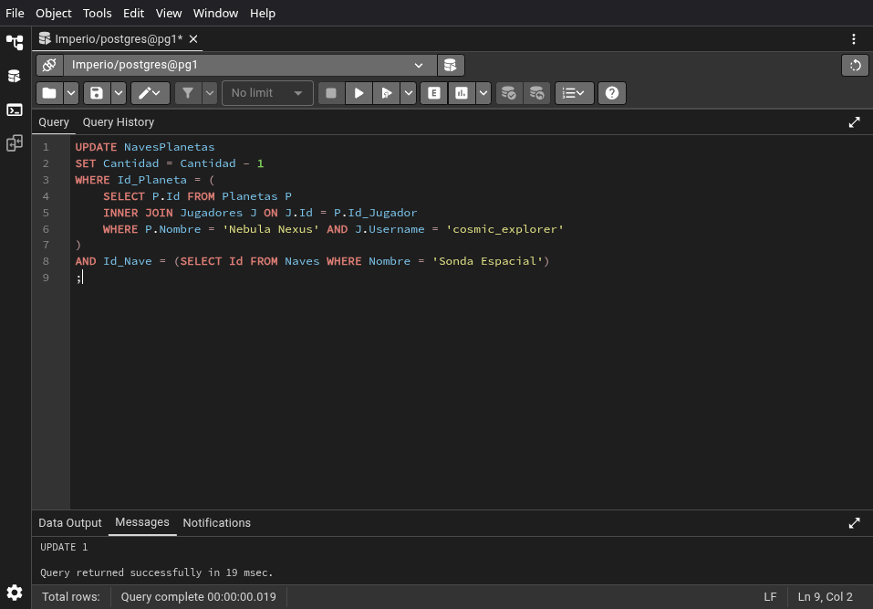
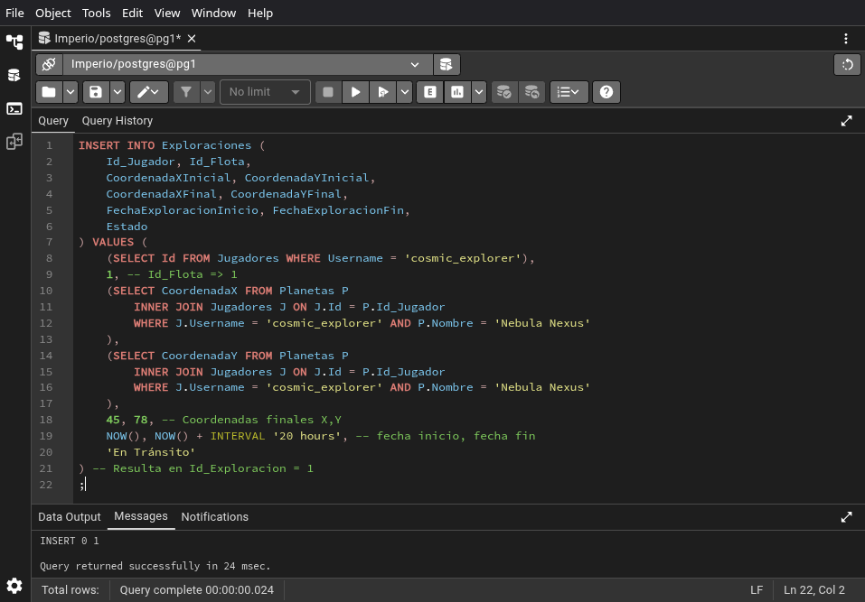
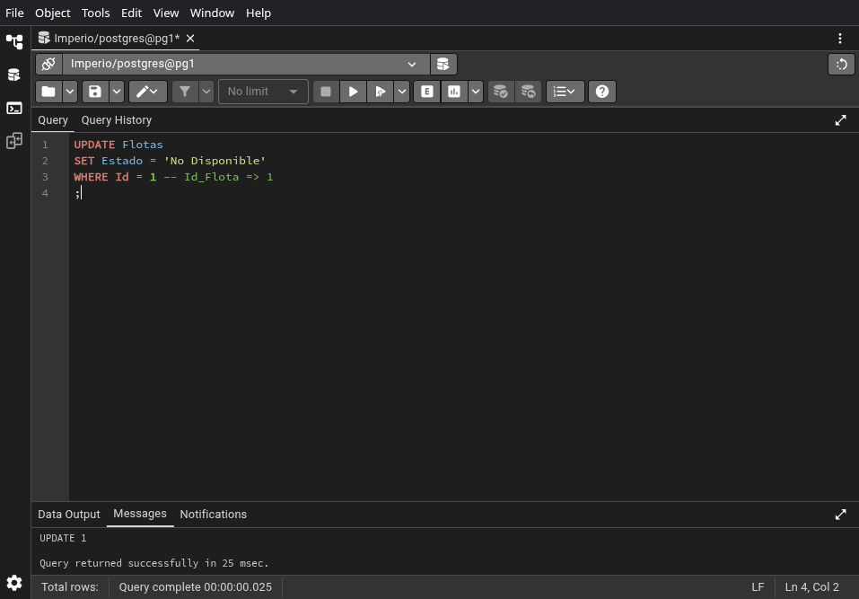

```sql
INSERT INTO NavesPlanetas (Id_Planeta, Id_Nave, Cantidad)
VALUES (
    (
        SELECT P.Id
        FROM Planetas P
        INNER JOIN Jugadores J ON J.Id = P.Id_Jugador
        WHERE J.Username = 'cosmic_explorer'
          AND P.Nombre = 'Nebula Nexus'
    ),
    (SELECT Id FROM Naves WHERE Nombre = 'Sonda Espacial'),
    1
);
```



\newpage


```sql
UPDATE RecursosPlanetas
SET Cantidad = Cantidad - (
    (SELECT Costo_R1 FROM Naves WHERE Nombre = 'Sonda Espacial')
)
WHERE Id_Planeta = (
    SELECT P.Id
    FROM Planetas P
    INNER JOIN Jugadores J ON J.Id = P.Id_Jugador
    WHERE J.Username = 'cosmic_explorer'
      AND P.Nombre = 'Nebula Nexus'
)
AND Id_Recurso = 1;
```


\newpage


```sql
UPDATE RecursosPlanetas
SET Cantidad = Cantidad - (
    (SELECT Costo_R2 FROM Naves WHERE Nombre = 'Sonda Espacial')
)
WHERE Id_Planeta = (
    SELECT P.Id
    FROM Planetas P
    INNER JOIN Jugadores J ON J.Id = P.Id_Jugador
    WHERE J.Username = 'cosmic_explorer'
      AND P.Nombre = 'Nebula Nexus'
)
AND Id_Recurso = 2;
```



\newpage


```sql
UPDATE RecursosPlanetas
SET Cantidad = Cantidad - (
    (SELECT Costo_R3 FROM Naves WHERE Nombre = 'Sonda Espacial')
)
WHERE Id_Planeta = (
    SELECT P.Id
    FROM Planetas P
    INNER JOIN Jugadores J ON J.Id = P.Id_Jugador
    WHERE J.Username = 'cosmic_explorer'
      AND P.Nombre = 'Nebula Nexus'
)
AND Id_Recurso = 3;
```


\newpage


```sql
INSERT INTO Flotas (Id_Planeta, SondaEspacial, Estado)
VALUES (
    (SELECT P.Id
    FROM Planetas P
    INNER JOIN Jugadores J ON J.Id = P.Id_Jugador
    WHERE J.Username = 'cosmic_explorer'
      AND P.Nombre = 'Nebula Nexus'),
    1,
    'Disponible'
) -- esto resulta en Flota con ID = 1
;
```



\newpage


```sql
UPDATE NavesPlanetas
SET Cantidad = Cantidad - 1
WHERE Id_Planeta = (
    SELECT P.Id FROM Planetas P
    INNER JOIN Jugadores J ON J.Id = P.Id_Jugador
    WHERE P.Nombre = 'Nebula Nexus' AND J.Username = 'cosmic_explorer'
)
AND Id_Nave = (SELECT Id FROM Naves WHERE Nombre = 'Sonda Espacial')
;
```



\newpage


```sql
INSERT INTO Exploraciones (
    Id_Jugador, Id_Flota,
    CoordenadaXInicial, CoordenadaYInicial,
    CoordenadaXFinal, CoordenadaYFinal,
    FechaExploracionInicio, FechaExploracionFin,
    Estado
) VALUES (
    (SELECT Id FROM Jugadores WHERE Username = 'cosmic_explorer'),
    1, -- Id_Flota => 1
    (SELECT CoordenadaX FROM Planetas P
        INNER JOIN Jugadores J ON J.Id = P.Id_Jugador
        WHERE J.Username = 'cosmic_explorer' AND P.Nombre = 'Nebula Nexus'
    ),
    (SELECT CoordenadaY FROM Planetas P
        INNER JOIN Jugadores J ON J.Id = P.Id_Jugador
        WHERE J.Username = 'cosmic_explorer' AND P.Nombre = 'Nebula Nexus'
    ),
    45, 78, -- Coordenadas finales X,Y
    NOW(), NOW() + INTERVAL '20 hours', -- fecha inicio, fecha fin
    'En Tránsito'   
) -- Resulta en Id_Exploracion = 1
;
```



\newpage


```sql
UPDATE Flotas
SET Estado = 'No Disponible'
WHERE Id = 1 -- Id_Flota => 1
;
```



\newpage


