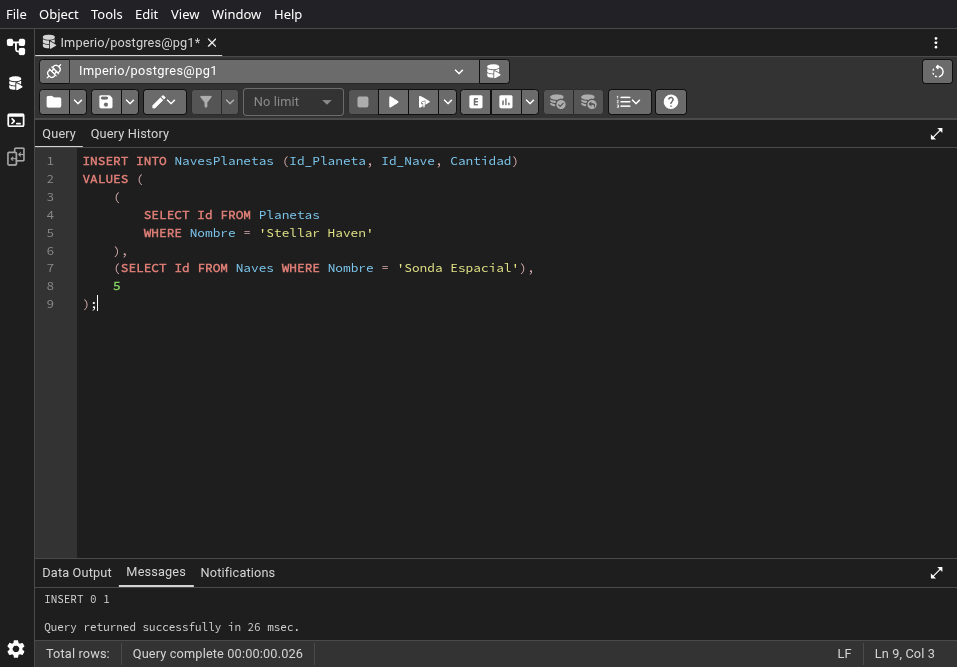
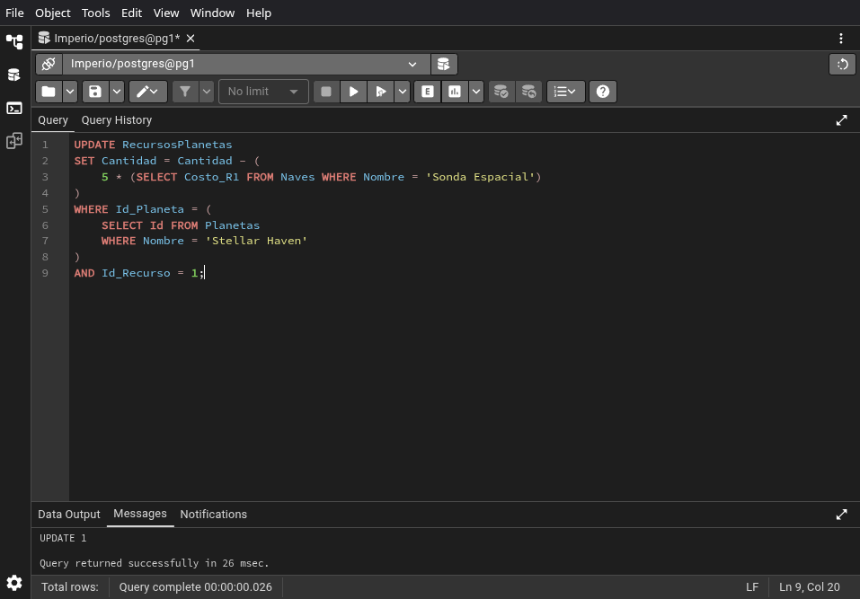
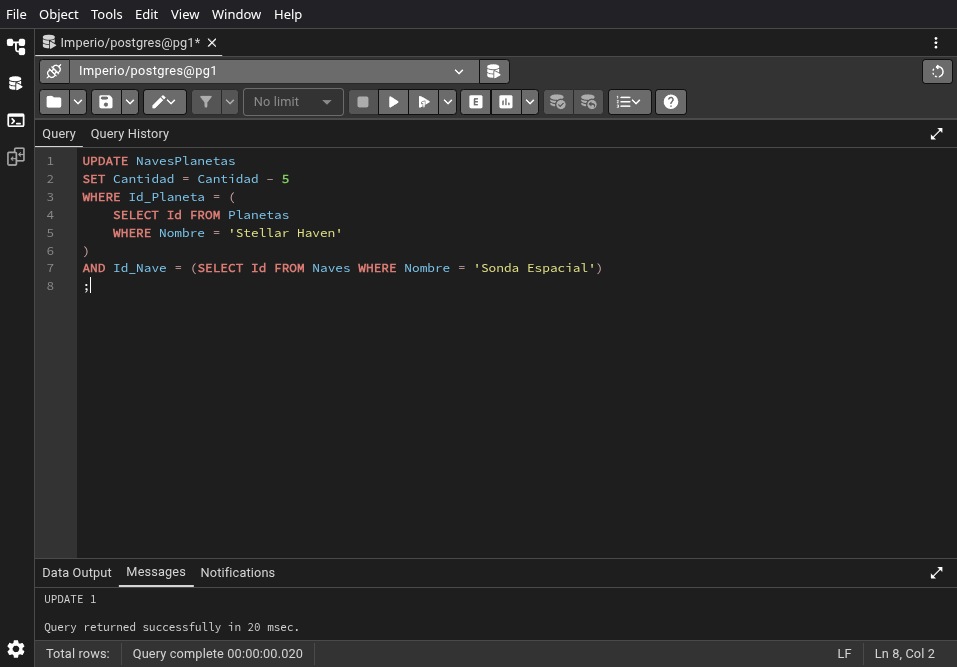
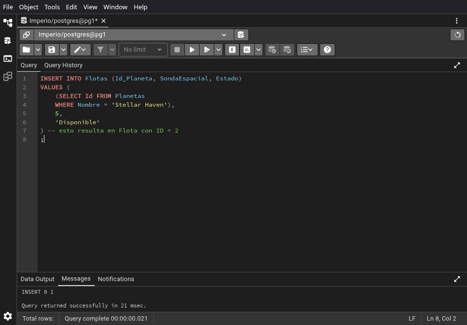
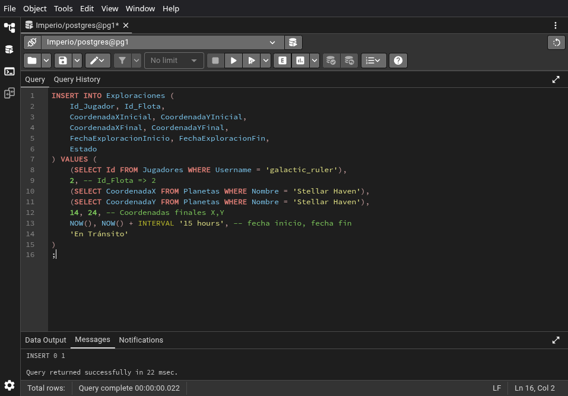
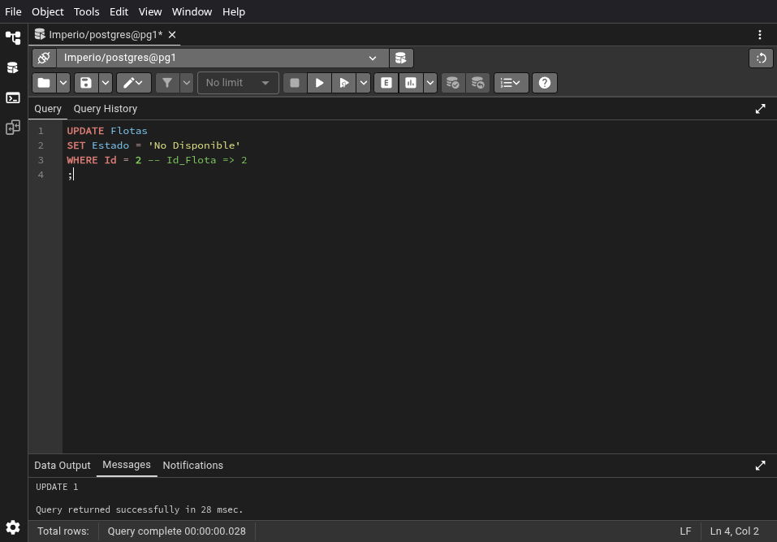
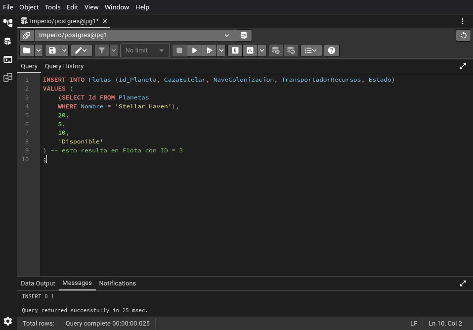
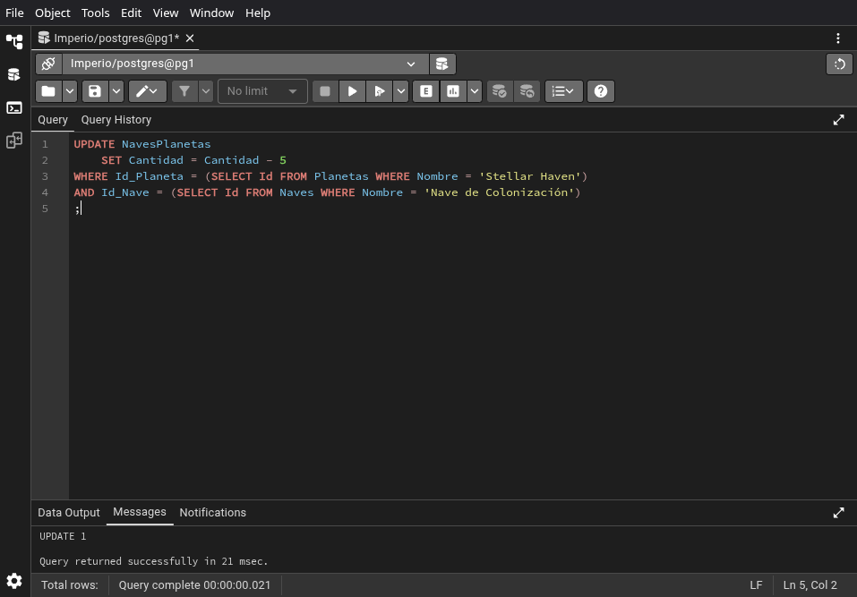
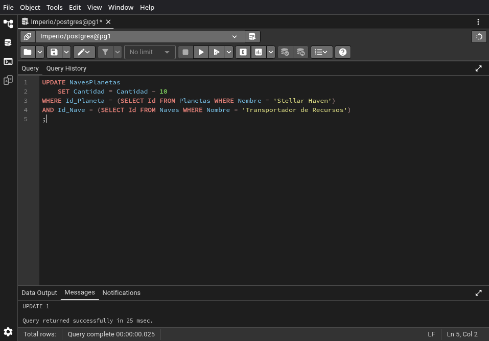

```sql
INSERT INTO NavesPlanetas (Id_Planeta, Id_Nave, Cantidad)
VALUES (
    (
        SELECT Id FROM Planetas
        WHERE Nombre = 'Stellar Haven'
    ),
    (SELECT Id FROM Naves WHERE Nombre = 'Sonda Espacial'),
    5
);
```



\newpage


```sql
UPDATE RecursosPlanetas
SET Cantidad = Cantidad - (
    5 * (SELECT Costo_R1 FROM Naves WHERE Nombre = 'Sonda Espacial')
)
WHERE Id_Planeta = (
    SELECT Id FROM Planetas
    WHERE Nombre = 'Stellar Haven'
)
AND Id_Recurso = 1;
```



\newpage


```sql
UPDATE RecursosPlanetas
SET Cantidad = Cantidad - (
    5 * (SELECT Costo_R2 FROM Naves WHERE Nombre = 'Sonda Espacial')
)
WHERE Id_Planeta = (
    SELECT Id FROM Planetas
    WHERE Nombre = 'Stellar Haven'
)
AND Id_Recurso = 2;
```


\newpage


```sql
UPDATE RecursosPlanetas
SET Cantidad = Cantidad - (
    5 * (SELECT Costo_R3 FROM Naves WHERE Nombre = 'Sonda Espacial')
)
WHERE Id_Planeta = (
    SELECT Id FROM Planetas
    WHERE Nombre = 'Stellar Haven'
)
AND Id_Recurso = 3;
```


\newpage


```sql
UPDATE NavesPlanetas
SET Cantidad = Cantidad - 5
WHERE Id_Planeta = (
    SELECT Id FROM Planetas
    WHERE Nombre = 'Stellar Haven'
)
AND Id_Nave = (SELECT Id FROM Naves WHERE Nombre = 'Sonda Espacial')
;
```



\newpage


```sql
INSERT INTO Flotas (Id_Planeta, SondaEspacial, Estado)
VALUES (
    (SELECT Id FROM Planetas
    WHERE Nombre = 'Stellar Haven'),
    5,
    'Disponible'
) -- esto resulta en Flota con ID = 2
;
```



\newpage


```sql
INSERT INTO Exploraciones (
    Id_Jugador, Id_Flota,
    CoordenadaXInicial, CoordenadaYInicial,
    CoordenadaXFinal, CoordenadaYFinal,
    FechaExploracionInicio, FechaExploracionFin,
    Estado
) VALUES (
    (SELECT Id FROM Jugadores WHERE Username = 'galactic_ruler'),
    2, -- Id_Flota => 2
    (SELECT CoordenadaX FROM Planetas WHERE Nombre = 'Stellar Haven'),
    (SELECT CoordenadaY FROM Planetas WHERE Nombre = 'Stellar Haven'),
    14, 24, -- Coordenadas finales X,Y
    NOW(), NOW() + INTERVAL '15 hours', -- fecha inicio, fecha fin
    'En Tránsito'   
)
;
```



\newpage


```sql
UPDATE Flotas
SET Estado = 'No Disponible'
WHERE Id = 2 -- Id_Flota => 2
;
```



\newpage


```sql
INSERT INTO Flotas (Id_Planeta, CazaEstelar, NaveColonizacion, TransportadorRecursos, Estado)
VALUES (
    (SELECT Id FROM Planetas
    WHERE Nombre = 'Stellar Haven'),
    20,
    5,
    10,
    'Disponible'
) -- esto resulta en Flota con ID = 3
;
```



\newpage


```sql
UPDATE NavesPlanetas
    SET Cantidad = Cantidad - 20
WHERE Id_Planeta = (SELECT Id FROM Planetas WHERE Nombre = 'Stellar Haven')
AND Id_Nave = (SELECT Id FROM Naves WHERE Nombre = 'Caza Estelar')
;
```


\newpage


```sql
UPDATE NavesPlanetas
    SET Cantidad = Cantidad - 5
WHERE Id_Planeta = (SELECT Id FROM Planetas WHERE Nombre = 'Stellar Haven')
AND Id_Nave = (SELECT Id FROM Naves WHERE Nombre = 'Nave de Colonización')
;
```



\newpage


```sql
UPDATE NavesPlanetas
    SET Cantidad = Cantidad - 10
WHERE Id_Planeta = (SELECT Id FROM Planetas WHERE Nombre = 'Stellar Haven')
AND Id_Nave = (SELECT Id FROM Naves WHERE Nombre = 'Transportador de Recursos')
;
```



\newpage


