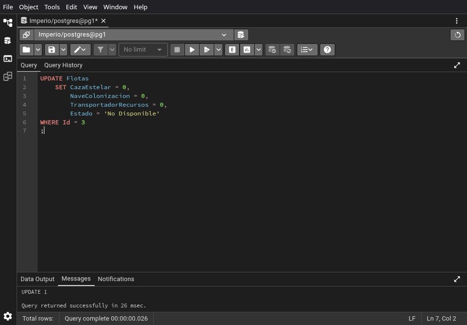
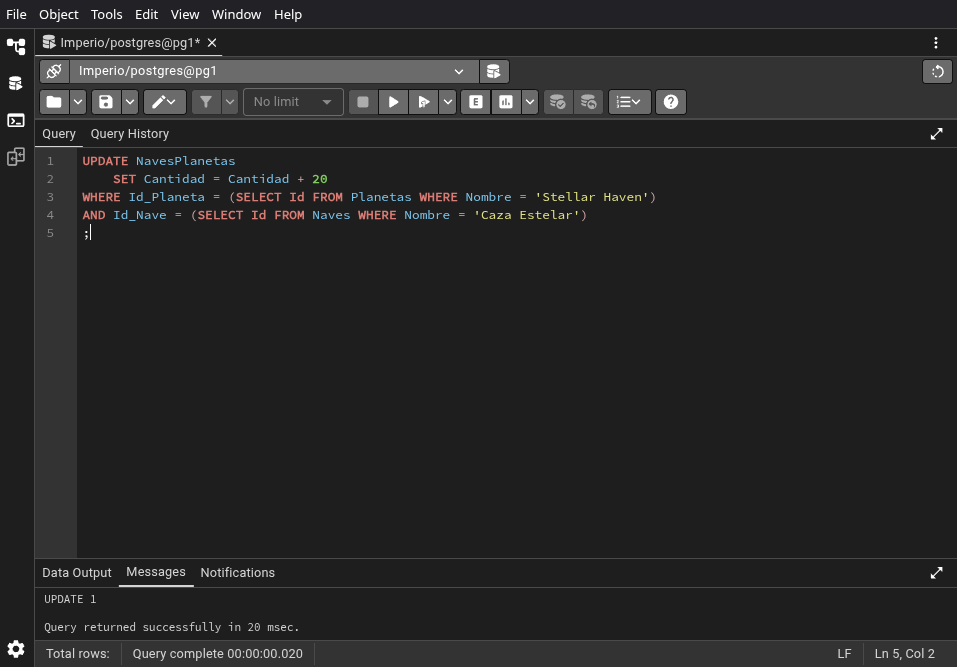
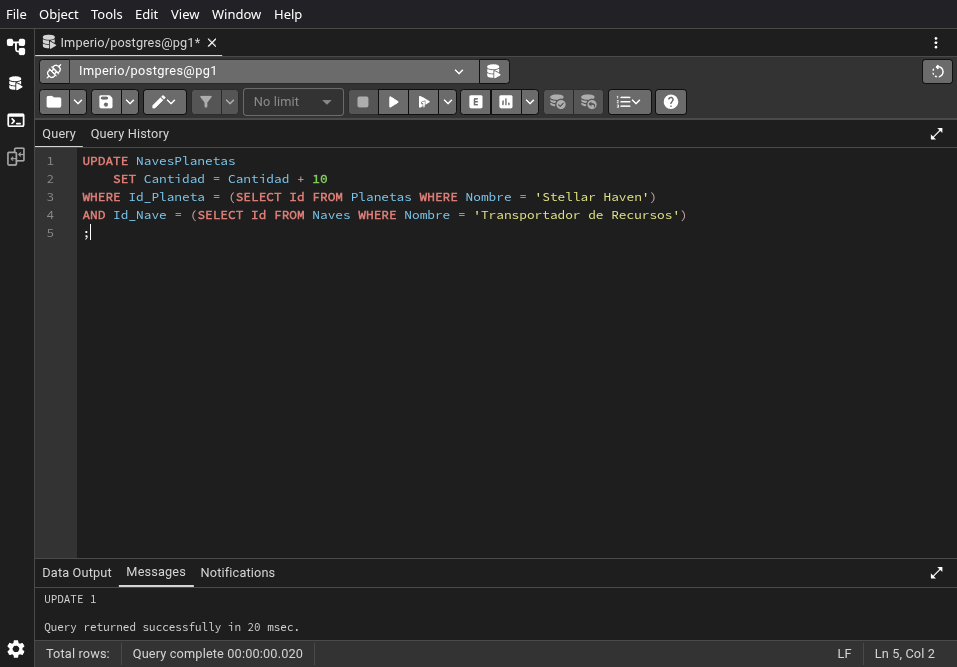
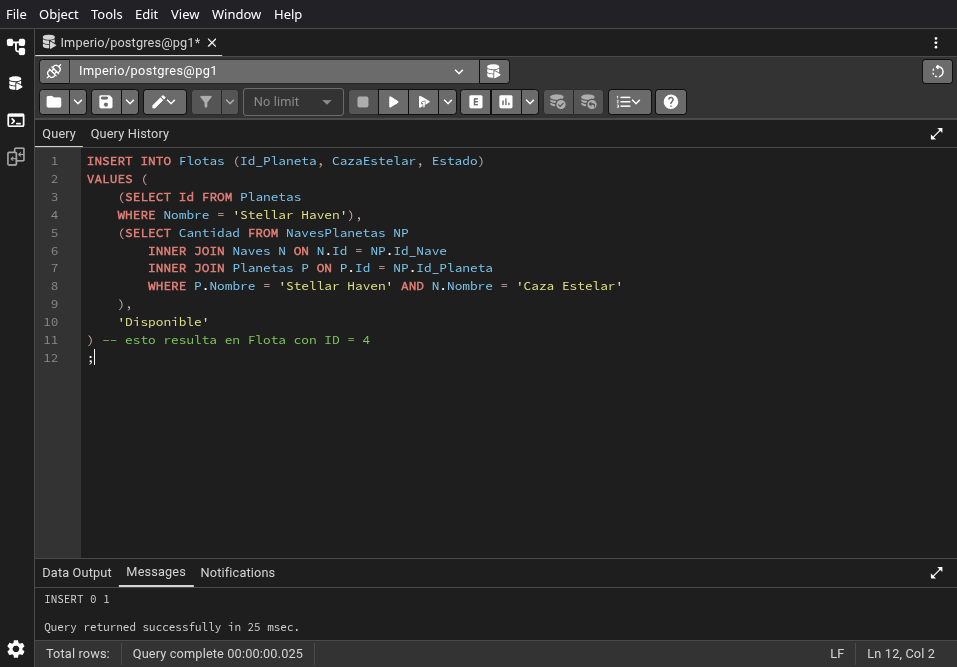
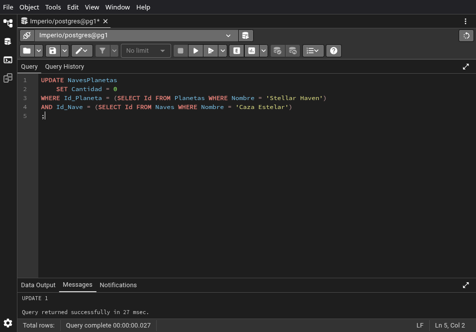
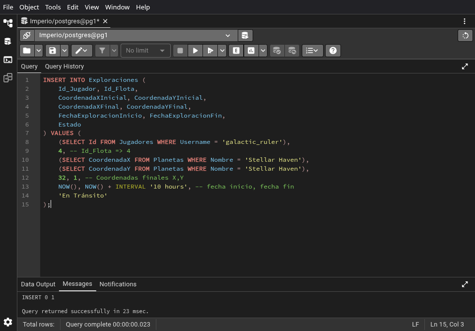
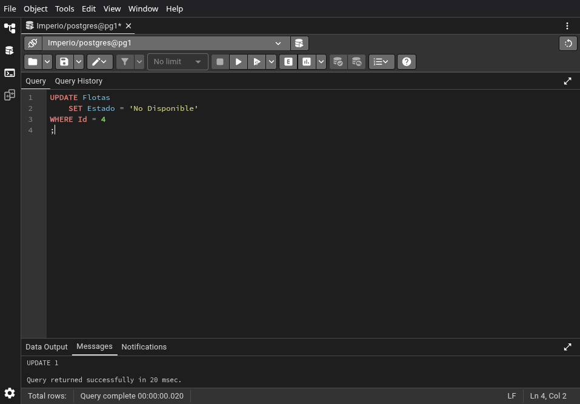

```sql
UPDATE Flotas
    SET CazaEstelar = 0,
        NaveColonizacion = 0,
        TransportadorRecursos = 0,
        Estado = 'No Disponible'
WHERE Id = 3
;
```



\newpage


```sql
UPDATE NavesPlanetas
    SET Cantidad = Cantidad + 20
WHERE Id_Planeta = (SELECT Id FROM Planetas WHERE Nombre = 'Stellar Haven')
AND Id_Nave = (SELECT Id FROM Naves WHERE Nombre = 'Caza Estelar')
;
```



\newpage


```sql
UPDATE NavesPlanetas
    SET Cantidad = Cantidad + 5
WHERE Id_Planeta = (SELECT Id FROM Planetas WHERE Nombre = 'Stellar Haven')
AND Id_Nave = (SELECT Id FROM Naves WHERE Nombre = 'Nave de Colonización')
;
```


\newpage


```sql
UPDATE NavesPlanetas
    SET Cantidad = Cantidad + 10
WHERE Id_Planeta = (SELECT Id FROM Planetas WHERE Nombre = 'Stellar Haven')
AND Id_Nave = (SELECT Id FROM Naves WHERE Nombre = 'Transportador de Recursos')
;
```



\newpage


```sql
INSERT INTO Flotas (Id_Planeta, CazaEstelar, Estado)
VALUES (
    (SELECT Id FROM Planetas
    WHERE Nombre = 'Stellar Haven'),
    (SELECT Cantidad FROM NavesPlanetas NP
        INNER JOIN Naves N ON N.Id = NP.Id_Nave
        INNER JOIN Planetas P ON P.Id = NP.Id_Planeta
        WHERE P.Nombre = 'Stellar Haven' AND N.Nombre = 'Caza Estelar'
    ),
    'Disponible'
) -- esto resulta en Flota con ID = 4
;
```



\newpage


```sql
UPDATE NavesPlanetas
    SET Cantidad = 0
WHERE Id_Planeta = (SELECT Id FROM Planetas WHERE Nombre = 'Stellar Haven')
AND Id_Nave = (SELECT Id FROM Naves WHERE Nombre = 'Caza Estelar')
;
```



\newpage


```sql
INSERT INTO Exploraciones (
    Id_Jugador, Id_Flota,
    CoordenadaXInicial, CoordenadaYInicial,
    CoordenadaXFinal, CoordenadaYFinal,
    FechaExploracionInicio, FechaExploracionFin,
    Estado
) VALUES (
    (SELECT Id FROM Jugadores WHERE Username = 'galactic_ruler'),
    4, -- Id_Flota => 4
    (SELECT CoordenadaX FROM Planetas WHERE Nombre = 'Stellar Haven'),
    (SELECT CoordenadaY FROM Planetas WHERE Nombre = 'Stellar Haven'),
    32, 1, -- Coordenadas finales X,Y
    NOW(), NOW() + INTERVAL '10 hours', -- fecha inicio, fecha fin
    'En Tránsito'   
);
```



\newpage


```sql
UPDATE Flotas
    SET Estado = 'No Disponible'
WHERE Id = 4
;
```



\newpage


